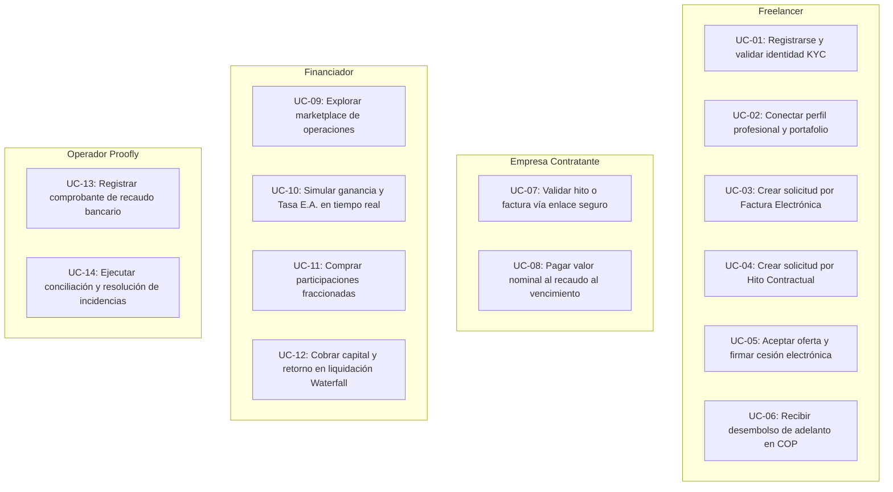

# Actores y Casos de Uso — Proofly (`docs/00-contexto/actors-usecases.md`)

Este documento detalla los actores del ecosistema de **Proofly**, sus casos de uso principales y la especificación de sus viajes de usuario (*User Journeys*) de punta a punta.

---

## 1. Catálogo de Actores

| Actor | Tipo | Descripción y Rol en Proofly |
| :--- | :---: | :--- |
| **Freelancer** | Humano (Primario) | Profesional independiente o prestador de servicios que necesita liquidez inmediata sobre facturas emitidas o contratos con hitos de entrega. |
| **Financiador** | Humano (Primario) | Persona natural o jurídica que busca rentabilizar su capital aportando liquidez a operaciones verificadas a cambio de un retorno predecible. |
| **Empresa Contratante** | Humano / Jurídico | Cliente pagador que contrata los servicios del freelancer, confirma la veracidad de los hitos o facturas y efectúa el pago final en la cuenta de recaudo. |
| **Operador / Conciliador** | Humano (Interno) | Equipo técnico y de operaciones de Proofly encargado de validar recaudos bancarios, resolver excepciones y vigilar la consistencia on-chain/off-chain. |
| **Servicio RADIAN / DIAN** | Sistema Externo | Registro oficial de facturación electrónica de Colombia para consulta y registro de eventos como título valor. |
| **Pasarela Bancaria / PSE / ACH** | Sistema Externo | Riel financiero tradicional para recepción de pagos de empresas contratantes y desembolsos a cuentas de freelancers y financiadores. |
| **Red Base (L2 EVM)** | Sistema Externo | Blockchain donde residen los contratos de registro (`ProoflyKYCRegistry`) y titularidad/liquidación (`ProoflyOperations`). |

---

## 2. Mapa General de Casos de Uso

---

## 3. Viajes de Usuario Detallados (User Journeys)

### 3.1. Viaje del Freelancer (De la necesidad de liquidez al desembolso)

1. **Onboarding Ágil (5 minutos):**
   - El freelancer ingresa a la aplicación móvil o web de Proofly.
   - Digita su correo y recibe un Magic Link / OTP.
   - Sube foto de su cédula y una selfie biométrica; el sistema valida antecedentes mediante `KycPort`.
   - Conecta su GitHub/LinkedIn o carga enlaces a su portafolio.
   - **Resultado:** Se le asigna el **Tier Semilla (Nivel 1)** con un cupo inicial disponible de $ 2.000.000 COP.

2. **Solicitud de Adelanto (Factura o Hito):**
   - **Opción A (Factura):** Sube el XML de la factura electrónica. El sistema valida automáticamente los 3 eventos en RADIAN.
   - **Opción B (Hito):** Ingresa los datos del cliente, valor nominal ($ 1.500.000 COP), fecha de entrega y enlace al entregable.
   - El sistema calcula la cotización en milisegundos:
     - Valor Nominal: `$ 1.500.000 COP`
     - Descuento Comercial (30 días): `-$ 45.000 COP`
     - Fee Proofly (1 %): `-$ 15.000 COP`
     - **Adelanto Neto a Recibir Hoy:** **`$ 1.440.000 COP`**
   - El freelancer acepta la oferta con su firma electrónica vinculante.

3. **Verificación y Fondeo:**
   - La empresa contratante recibe una notificación/enlace y confirma el hito en 1 clic.
   - La operación se publica en el Marketplace para los financiadores.
   - Una vez fondeada al 100 %, el contrato inteligente registra el token y la pasarela bancaria transfiere los `$ 1.440.000 COP` a la cuenta bancaria del freelancer.

---

### 3.2. Viaje de la Empresa Contratante (Confirmación y Pago sin fricción)

1. **Aprobación del Hito:**
   - El representante de la empresa recibe un correo o mensaje con un enlace seguro (`https://proofly.co/verify/[token-uuid]`).
   - Visualiza la descripción del servicio prestado por el freelancer y el entregable adjunto.
   - Presiona el botón negro en píldora: **"Confirmar Hito y Compromiso de Pago"**. No requiere crear una cuenta bancaria ni descargar apps.
2. **Pago al Vencimiento:**
   - 5 días antes de la fecha límite, la empresa recibe un recordatorio con la referencia única de recaudo bancario (PSE / Transferencia a cuenta fiduciaria de Proofly).
   - Efectúa el pago por el 100 % del valor nominal (`$ 1.500.000 COP`).

---

### 3.3. Viaje del Financiador (De la exploración al cobro de rendimientos)

1. **Exploración del Marketplace:**
   - El financiador ingresa a su Dashboard en Modo Claro.
   - Observa la tarjeta Bento de métricas con su capital invertido y retorno acumulado en verde (`+$ 520.000 COP`).
   - En la lista de operaciones disponibles, filtra por plazo (15, 30 o 60 días) y nivel de riesgo.
   - Selecciona la operación: *Desarrollo Frontend React (Hito 2)*:
     - Freelancer: Tier 2 (Score 88/100 · 4 hitos exitosos).
     - Empresa Pagadora: Score Solvencia A (Historial de pago puntual).
     - Plazo: 30 días · Tasa E.A. ofrecida: **18.5 %**.
2. **Simulación y Compra:**
   - El financiador decide aportar `$ 500.000 COP`.
   - El simulador le indica con total transparencia:
     - Capital a aportar: `$ 500.000 COP`
     - Ganancia neta al vencimiento: **`$ 11.250 COP`** (en 30 días)
     - Total a recibir al vencimiento: **`$ 511.250 COP`**
   - Confirma con su PIN/biometría. El saldo se descuenta y se le asigna su cuota parte de los tokens ERC-1155 on-chain.
3. **Liquidación y Cobro:**
   - Al cumplirse el vencimiento y recibirse el pago de la empresa, el protocolo ejecuta la cascada (Waterfall).
   - El saldo del financiador se acredita automáticamente con `$ 511.250 COP` disponibles para reinvertir o retirar a su banco vía PSE/ACH.

---

### 3.4. Viaje del Operador / Conciliador

1. **Conciliación Diaria:**
   - Revisa el panel de conciliación entre depósitos recibidos en el banco y eventos de liquidación pendientes en Base.
   - Sube o confirma el hash del extracto bancario; el sistema dispara `settleOperation` en el contrato `ProoflyOperations`.
   - Supervisa que la tabla `outbox` procese transacciones con cero atascos de gas.

