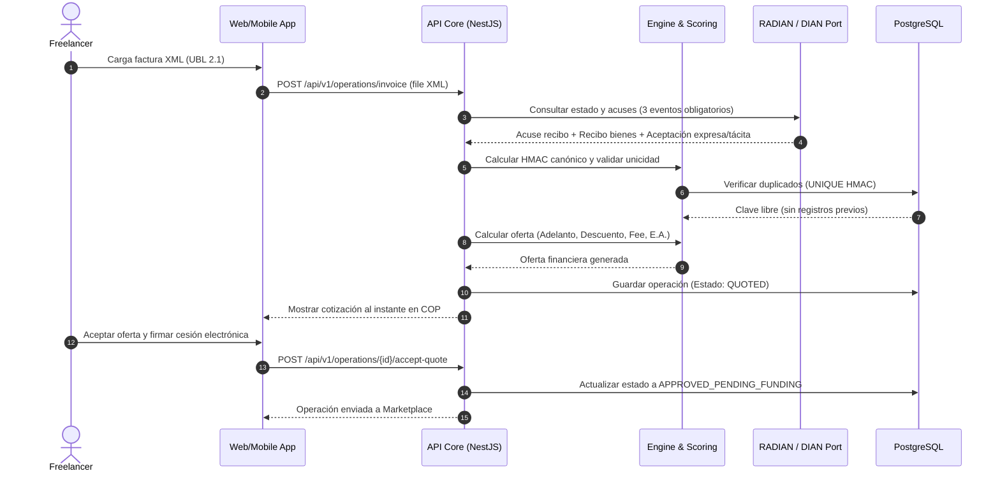
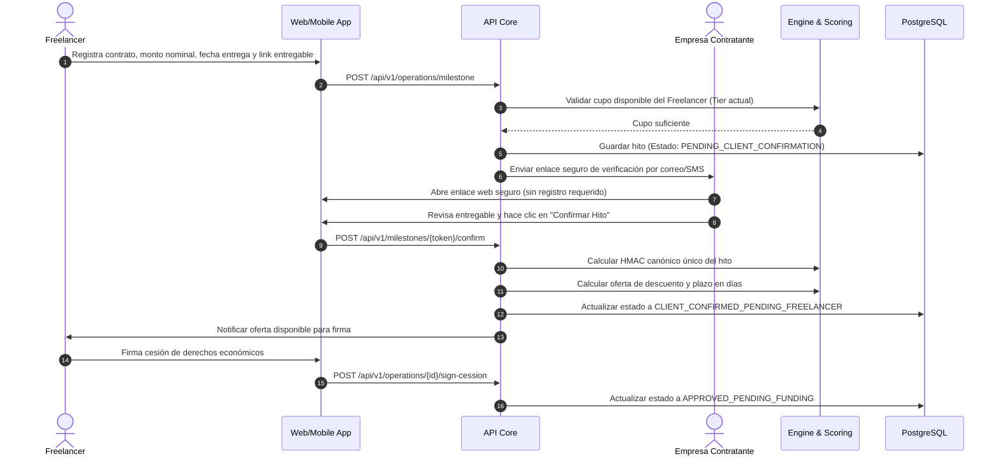
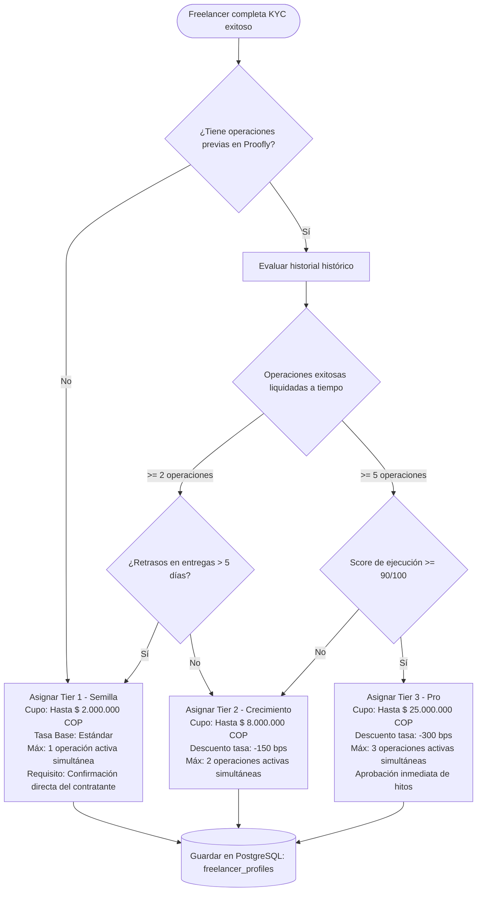
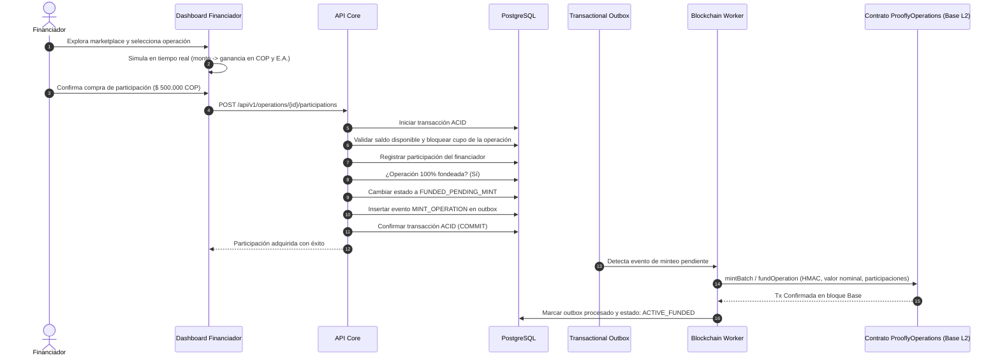
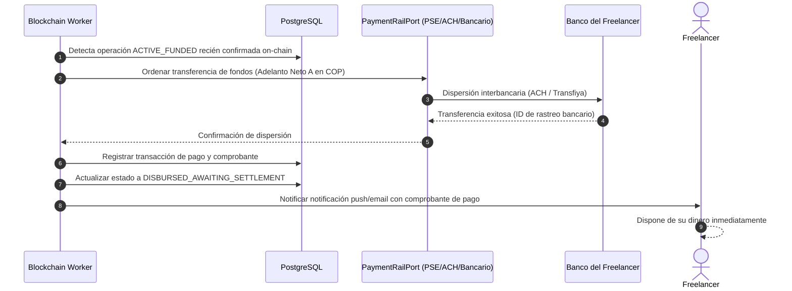
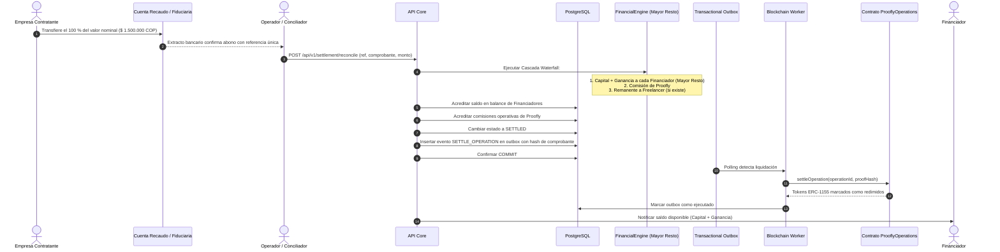
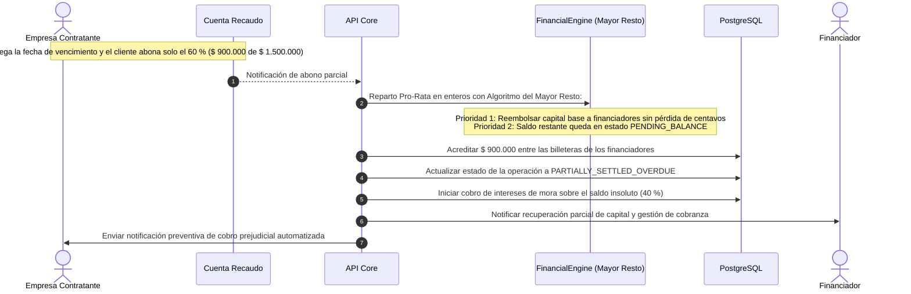

# Procesos de Negocio en Mermaid — Proofly (`docs/00-contexto/business-processes.md`)

Este documento modela mediante diagramas de secuencia e interacción en Mermaid los siete procesos de negocio esenciales de **Proofly**, cubriendo el ciclo de vida completo de originación, evaluación de cupo, fondeo, desembolso y liquidación en cascada.

---

## 1. Proceso 1: Originación por Factura Electrónica

---

## 2. Proceso 2: Originación por Hito Contractual (Milestone)

---

## 3. Proceso 3: Cálculo de Cupo Progresivo (Tiers para Freelancers)

---

## 4. Proceso 4: Publicación y Fondeo por Financiadores (Marketplace)

---

## 5. Proceso 5: Desembolso del Adelanto al Freelancer

---

## 6. Proceso 6: Recaudo y Distribución de Ganancias (Waterfall)

---

## 7. Proceso 7: Pago Parcial y Gestión de Mora

