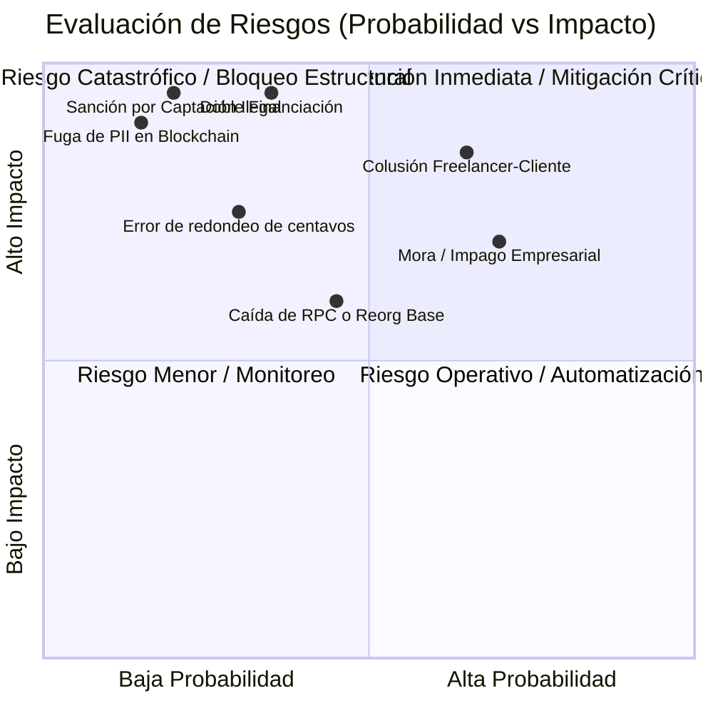

# Matriz de Riesgos y Mitigaciones — Proofly (`docs/00-contexto/risks.md`)

Este documento identifica y analiza los riesgos críticos (técnicos, financieros, jurídicos y operativos) de **Proofly**, asignando probabilidad, impacto y salvaguardas arquitectónicas inmutables.

---

## 1. Mapa de Calor de Riesgos

---

## 2. Matriz Detallada de Riesgos y Mitigaciones

| ID | Riesgo Identificado | Tipo | Prob. | Imp. | Salvaguarda y Mitigación Arquitectónica |
| :-: | :--- | :---: | :---: | :---: | :--- |
| **R-01** | **Colusión entre Freelancer y Empresa Contratante** *(Creación de hitos o facturas ficticias para desviar el adelanto)* | Fraude / Negocio | Media | Alta | • **Separación de Riesgos (Invariante I14):** Se calcula Score de Ejecución del Freelancer y Score de Solvencia de la Empresa de forma independiente. • **Niveles de Cupo Progresivos (Tier Semilla):** Freelancers nuevos inician con un cupo máximo acotado ($ 2.000.000 COP) y requieren validación del cliente. • **Verificación de Empresa:** Para personas jurídicas se valida NIT activo en DIAN y existencia en RUES/Cámara de Comercio. |
| **R-02** | **Doble Financiación de la Misma Operación** *(Financiar dos veces el mismo hito en Proofly o registrar una factura ya cedida en otro factor)* | Integridad Financiera | Baja | Crítica | • **Clave Única Anti-Duplicado (Invariante I5):** `HMAC-SHA256(secret, payload)` indexado como `UNIQUE` en PostgreSQL y almacenado en mapping de `ProoflyOperations` Solidity. • **Validación RADIAN en tiempo real:** Para facturas electrónicas, verificación estricta de que el título valor no posea endosos previos ni limitaciones al cobro. |
| **R-03** | **Impago o Retraso de la Empresa Contratante** *(Cliente no paga en la fecha de vencimiento acordada)* | Crédito / Liquidez | Alta | Media | • **Cuenta de Recaudo Fiduciaria (Invariante I10):** Pagos dirigidos exclusivamente a cuenta bajo control de Proofly. • **Transparencia de Riesgo al Financiador (Invariante I4):** El financiador conoce el perfil crediticio antes de aportar capital; no se prometen inversiones libres de riesgo. • **Algoritmo de Pagos Parciales:** En pagos parciales, el Algoritmo del Mayor Resto reembolsa primero capital proporcional a los financiadores. • **Gestión prejudicial automatizada:** Notificaciones y cálculo de intereses de mora automáticos. |
| **R-04** | **Fallas en la Capa Blockchain (RPC Down / Reorgs)** *(Nodo RPC inaccesible o reorganización de bloques en Base)* | Técnico / Infra | Media | Media | • **Transactional Outbox (Invariante I8):** Las transacciones no se envían sincrónicamente desde la API; se insertan en PostgreSQL y un worker asíncrono gestiona reintentos con backoff exponencial. • **Espera de Finalidad:** El conciliador espera 12 confirmaciones de bloque antes de marcar una liquidación como irreversible. |
| **R-05** | **Riesgo Regulatorio de Captación Masiva e Ilegal** *(Interpretación errónea de que Proofly capta ahorro del público)* | Jurídico / Cumplimiento | Muy Baja | Crítica | • **Estructura de Cesión de Créditos (Invariante I1):** Cada participación on-chain representa derechos económicos sobre una operación concreta elegida por el financiador; no hay depósitos pasivos garantizados ni mutualización de fondos opaca. • **Sin Token Especulativo:** Prohibida la emisión de tokens volátiles de plataforma. |
| **R-06** | **Violación de Privacidad de Datos (Ley 1581 de 2012)** *(Exposición de datos personales o secretos comerciales on-chain)* | Jurídico / Privacidad | Baja | Crítica | • **Privacidad On-Chain Estricta (Invariante I3):** Solo hashes criptográficos, identificadores numéricos opacos y marcas temporales se registran en Base. Nombres, RUTs y contratos se almacenan cifrados off-chain. |
| **R-07** | **Pérdida de Centavos por Redondeo de Punto Flotante** *(Descuadres contables al liquidar entre decenas de financiadores)* | Integridad Financiera | Media | Media | • **Aritmética Entera Estricta (Invariante I9):** Cálculos en centavos (`bigint`/`uint256`) y distribución por el **Algoritmo del Mayor Resto**, garantizando $\sum \text{partes} = \text{total}$. |

---

## 3. Protocolo de Escalamiento ante Fraude o Incumplimiento

1. **Detección Temprana:** Discrepancia en comprobante de pago o vencimiento de hito sin confirmación tras 5 días hábiles.
2. **Bloqueo Inmediato:** El estado del freelancer pasa automáticamente a `SUSPENDED_REVIEW` en base de datos y se desactiva temporalmente en `ProoflyKYCRegistry`.
3. **Cobro Prejudicial:** Notificación electrónica certificada con mérito ejecutivo a la empresa contratante adjuntando el documento de cesión firmado.
4. **Liquidación de Remanentes:** Aplicación inmediata de cualquier saldo recuperado al balance de los financiadores vía Waterfall.

