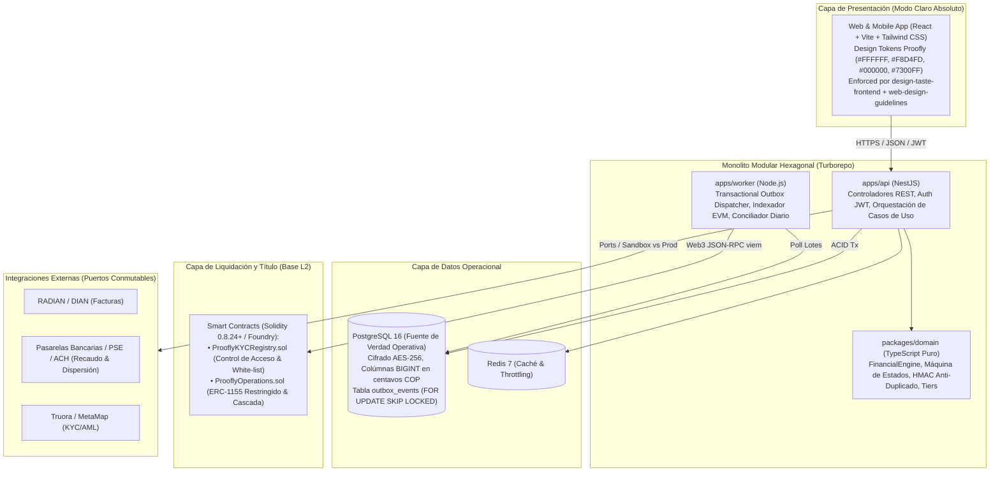

# Documento Maestro de Arquitectura v1.0 — Proofly (`docs/architecture/00-architecture-overview.md`)

Este documento constituye la **visión unificada y puerta de entrada técnica** a la arquitectura completa de **Proofly**, congelada formalmente al cierre de la **Fase 1 (Puerta 1)**.

---

## 1. Visión Técnica y Propósito del Sistema

Proofly es una plataforma fintech de alta integridad construida para resolver la falta de liquidez en el sector de trabajadores independientes y creativos en Colombia:
1. **Para Freelancers:** Adelanto inmediato de flujos futuros en pesos colombianos (COP) mediante el descuento comercial de **Facturas Electrónicas** (títulos valores con eventos RADIAN) y **Contratos por Hitos (*Milestones*)**, estructurados como cesiones de crédito verificables.
2. **Para Financiadores:** Acceso a un marketplace de participaciones fraccionadas en Base L2 con cálculo determinista de retornos en COP y Tasa Efectiva Anual ($E.A.$) transparente.
3. **Para la Operación:** Conciliación bancaria automatizada con una cascada de pagos inmutable (**Waterfall**) ejecutada mediante el **Algoritmo del Mayor Resto**, garantizando $0 \text{ centavos}$ de error contable.

---

## 2. Mapa Arquitectónico Global

---

## 3. Índice Maestro de Documentos de Arquitectura

Toda la especificación técnica detallada se encuentra dividida en módulos temáticos exhaustivos:

| Documento | Enlace Directo | Contenido y Propósito |
| :--- | :--- | :--- |
| **01. Estilo y Mapa de Contextos** | [`01-style-and-context-map.md`](01-style-and-context-map.md) | Monolito hexagonal, Turborepo y 7 Bounded Contexts DDD. |
| **02. Diagramas C4** | [`02-c4-diagrams.md`](02-c4-diagrams.md) | Diagramas Mermaid C4 Niveles 1, 2 y 3. |
| **03. Puertos y Adaptadores** | [`03-ports-adapters.md`](03-ports-adapters.md) | 6 interfaces de dominio y conmutación Sandbox/Producción. |
| **04. Máquina de Estados Canónica** | [`04-state-machine.md`](04-state-machine.md) | 10 estados unificados, matriz de transiciones y badges UI. |
| **05. Prevención de Doble Financiación** | [`05-anti-double-financing.md`](05-anti-double-financing.md) | Fórmula `HMAC-SHA256` y cerrojo doble (PostgreSQL + Solidity). |
| **06. Modelo Financiero y Rendimientos**| [`06-financial-model.md`](06-financial-model.md) | Fórmulas exactas, Algoritmo del Mayor Resto y 6 escenarios. |
| **07. Eventos y Transactional Outbox** | [`07-events-consistency.md`](07-events-consistency.md) | Consistencia eventual, worker asíncrono y reorgs en Base. |
| **08. Modelo de Datos Relacional** | [`08-data-model.md`](08-data-model.md) | Entidades, ERD y DDL oficial en [`db/schema.sql`](../../db/schema.sql). |
| **09. Contratos Inteligentes Solidity** | [`09-smart-contract-spec.md`](09-smart-contract-spec.md) | Código Solidity de `ProoflyKYCRegistry` y `ProoflyOperations`. |
| **10. Especificación de API REST** | [`10-api-spec.md`](10-api-spec.md) | Contratos OpenAPI 3.1 oficiales en [`api/openapi.yaml`](../../api/openapi.yaml). |
| **11. Sincronización y Conciliación** | [`11-sync-and-reconciliation.md`](11-sync-and-reconciliation.md)| Worker `SKIP LOCKED`, indexador de 12 bloques y conciliación. |
| **12. Wallets Abstraídas y KYC** | [`12-wallets-kyc.md`](12-wallets-kyc.md) | Experiencia Web2 en COP, patrocinio de gas y sync KYC. |
| **13. Matriz de Trazabilidad Integral** | [`13-traceability-matrix.md`](13-traceability-matrix.md) | Mapeo de Invariantes I1 a I15 hacia código y endpoints. |
| **14. Modelo de Amenazas STRIDE** | [`14-threat-model.md`](14-threat-model.md) | Mitigación de 6 vectores STRIDE y 4 fraudes financieros. |
| **15. Matriz de Autorización** | [`15-authz-matrix.md`](15-authz-matrix.md) | Reglas RBAC/ABAC para endpoints y funciones on-chain. |
| **16. Privacidad (Ley 1581 de 2012)** | [`16-privacy-data-protection.md`](16-privacy-data-protection.md)| Cero PII on-chain y ejercicio de derechos ARCO. |
| **17. Cumplimiento Regulatorio** | [`17-compliance-by-design.md`](17-compliance-by-design.md) | Régimen dual (RADIAN / Cesión), topes de usura y SIC. |
| **18. Observabilidad y Métricas** | [`18-observability.md`](18-observability.md) | Logs Pino JSON, métricas Prometheus y alertas críticas. |
| **19. Estrategia de Calidad y Pruebas** | [`19-quality-strategy.md`](19-quality-strategy.md) | Fuzzing Foundry, fast-check y suite QA-01 a QA-06. |
| **20. Entornos y CI/CD** | [`20-environments-ci-cd.md`](20-environments-ci-cd.md) | Configuración tipada Zod y pipeline multi-red. |
| **21. Capacidad y Dimensionamiento** | [`21-capacity.md`](21-capacity.md) | Análisis de costos de gas Base L2 y volumen transaccional. |
| **22. Consistencia Cruzada** | [`22-consistency-report.md`](22-consistency-report.md) | Certificación de mapeo 1:1 entre enums, tablas y tipos. |
| **23. Revisión Adversarial** | [`23-adversarial-review.md`](23-adversarial-review.md) | Resolución mecánica de 15 escenarios de estrés extremo. |
| **24. Recorrido E2E sobre Papel** | [`24-e2e-walkthrough.md`](24-e2e-walkthrough.md) | Traza numérica real en centavos de una operación completa. |

---

## 4. Estado de las 15 Invariantes del Sistema

La arquitectura cumple de forma verificable con las 15 invariantes innegociables de Proofly:
- **I1 (COP):** Unidad comercial en centavos enteros; cero token volátil especulativo.
- **I2 (Multi-Entorno):** Conmutación Sandbox/Producción gobernada por `ENV_MODE` sin tocar código.
- **I3 (Privacidad On-Chain):** Cero PII o textos contractuales en Base L2; solo hashes opacos `bytes32`.
- **I4 (Claridad de Retornos):** Transparencia matemática en Tasa E.A. y Ganancia Neta en COP.
- **I5 (Anti-Duplicado):** Restricción `UNIQUE` en PostgreSQL y mapping en Solidity con clave HMAC.
- **I6 (Emisión Respaldada):** Minteo condicionado a identidad KYC, aprobación de cliente y dossier hasheado.
- **I7 (Transferencias Restringidas):** Tokens intransferibles a billeteras sin verificación activa en `ProoflyKYCRegistry`.
- **I8 (Puertos y Adaptadores):** Hexagonal desacoplado con interfaces TypeScript puras.
- **I9 (Exactitud Aritmética):** Cero redondeo flotante; reparto mediante Algoritmo del Mayor Resto.
- **I10 (Waterfall Inmutable):** Cascada determinista: Financiadores $\rightarrow$ Fee Proofly $\rightarrow$ Remanente.
- **I11 (Gobernanza):** Arquitectura v1.0 congelada formalmente; ADRs obligatorios para cambios estructurales.
- **I12 (Inclusión Freelancers):** Onboarding por Tiers con cupo inicial semilla de hasta $ 2.000.000 COP.
- **I13 (Hitos Contractuales):** Soporte nativo para contratos por tramos con entregables verificables.
- **I14 (Separación de Riesgos):** Score de Ejecución (Freelancer) independiente del Score de Solvencia (Empresa).
- **I15 (Modo Claro Absoluto):** `#FFFFFF`, `#F8D4FD`, `#000000`, `#7300FF`, verificado por skills de frontend instaladas.

