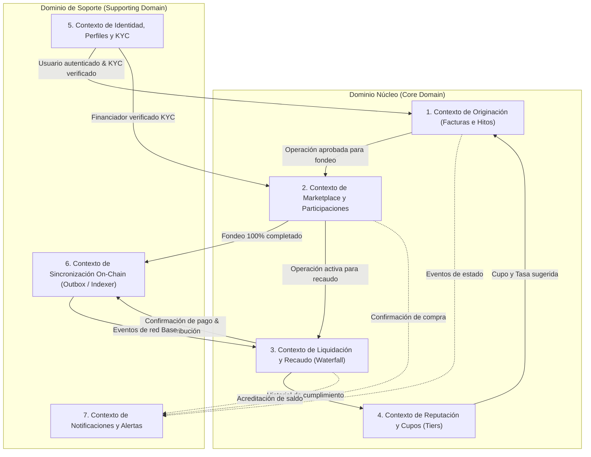

# Estilo Arquitectónico y Mapa de Contextos (DDD) — Proofly (`docs/architecture/01-style-and-context-map.md`)

Este documento define el estilo arquitectónico global de **Proofly** y el mapa de Contextos Delimitados (*Bounded Contexts*) bajo los principios de *Domain-Driven Design* (DDD) y Arquitectura Hexagonal (Puertos y Adaptadores).

---

## 1. Estilo Arquitectónico: Monolito Modular Hexagonal + Worker Asíncrono

### 1.1. Justificación de la Elección
Para una plataforma fintech en etapa de crecimiento con requisitos estrictos de consistencia transaccional (ACID), auditoría regulatoria y coordinación on-chain/off-chain, los microservicios distribuidos prematuros introducen latencia innecesaria, problemas de doble fase (*two-phase commit*) y complejidad operacional desmedida.

Se adopta un **Monolito Modular Hexagonal** complementado con un **Worker Asíncrono de Blockchain**, estructurados en un monorepo TypeScript gestionado con **Turborepo**:
- **Núcleo de Dominio Puro (`packages/domain`):** Tipos, entidades, agregados, máquinas de estado y el motor financiero (`FinancialEngine`) en TypeScript puro sin dependencias externas.
- **API Monolítica Modular (`apps/api`):** NestJS agrupado en módulos estrictos por contexto delimitado, interactuando con el dominio mediante puertos e interfaces inyectables.
- **Worker Asíncrono de Eventos y Cadena (`apps/worker`):** Proceso independiente que consume la tabla `outbox` de PostgreSQL, despacha transacciones a la red Base, escucha eventos de bloques y ejecuta la conciliación periódica.
- **Frontend Web & Mobile (`apps/web`):** Aplicación React + Vite + Tailwind CSS en Modo Claro Absoluto.
- **SDK de Contratos (`packages/contracts-sdk`):** ABIs tipados generados desde Foundry mediante `viem` / `wagmi`.

---

## 2. Mapa de Contextos Delimitados (Bounded Contexts)

---

## 3. Descripción Detallada de los Contextos

### 3.1. Contexto de Identidad y KYC (`Identity & KYC`)
* **Responsabilidad:** Registro, autenticación Web2 (magic link / OTP / JWT), perfiles de usuario (Freelancer, Financiador, Administrador) y orquestación del proceso de KYC/AML mediante `KycPort`.
* **Entidades Clave:** `User`, `FreelancerProfile`, `FinancierProfile`, `KycVerification`.
* **Invariante:** Ningún usuario puede originar operaciones ni comprar participaciones sin un KYC en estado `VERIFIED`.

### 3.2. Contexto de Reputación y Cupos (`Reputation & Quotas`)
* **Responsabilidad:** Cálculo del Score de Ejecución del Freelancer (puntualidad, valor entregado, historial) y Score de Solvencia de la Empresa Contratante (antigüedad, antecedentes comerciales). Asignación y ascenso de Tiers de Cupo (Tier 1 Semilla, Tier 2 Crecimiento, Tier 3 Pro).
* **Entidades Clave:** `FreelancerReputation`, `CompanyCreditScore`, `QuotaPolicy`.

### 3.3. Contexto de Originación (`Origination`)
* **Responsabilidad:** Ciclo de vida inicial de la operación. Carga y validación de facturas electrónicas ante RADIAN (`InvoiceVerificationPort`), registro de hitos contractuales, generación de enlace de confirmación para el cliente (`MilestoneConfirmationPort`), cálculo de clave HMAC única canónica y firma electrónica de cesión.
* **Entidades Clave:** `Operation`, `InvoiceMetadata`, `MilestoneMetadata`, `CessionAgreement`.

### 3.4. Contexto de Marketplace y Participaciones (`Marketplace & Participations`)
* **Responsabilidad:** Catálogo público de operaciones fondeables para financiadores. Motor de simulación en tiempo real (monto -> ganancia en COP y E.A.). Registro transaccional de compras fraccionadas y cierre de ronda de fondeo.
* **Entidades Clave:** `MarketListing`, `Participation`, `FinancierWallet`.

### 3.5. Contexto de Liquidación y Recaudo (`Settlement & Waterfall`)
* **Responsabilidad:** Conciliación del recaudo bancario pagado por la empresa contratante. Ejecución estricta de la Cascada de Pagos (**Waterfall**) mediante el **Algoritmo del Mayor Resto** (Capital + Rendimiento a Financiadores -> Fee Proofly -> Remanente). Tratamiento de pagos parciales y cálculo de mora.
* **Entidades Clave:** `BankReceipt`, `SettlementExecution`, `DistributionShare`, `DefaultIncident`.

### 3.6. Contexto de Sincronización On-Chain (`Blockchain Sync`)
* **Responsabilidad:** Despacho atómico e idempotente de transacciones a la red Base mediante el patrón Transactional Outbox. Indexación de eventos de `ProoflyOperations` y `ProoflyKYCRegistry`. Conciliación diaria entre saldos en PostgreSQL y el estado on-chain.
* **Entidades Clave:** `OutboxEvent`, `IndexedChainEvent`, `ReconciliationReport`.

### 3.7. Contexto de Notificaciones (`Notifications`)
* **Responsabilidad:** Envío multicanal (Email, SMS, Webhook) de enlaces de confirmación a pagadores, alertas de fondeo completado, comprobantes de pago bancario y avisos de cobro de rendimientos.
* **Entidades Clave:** `NotificationTemplate`, `NotificationDeliveryLog`.

