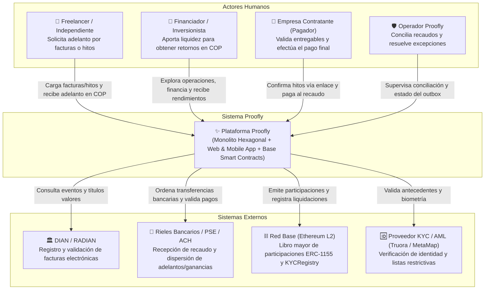
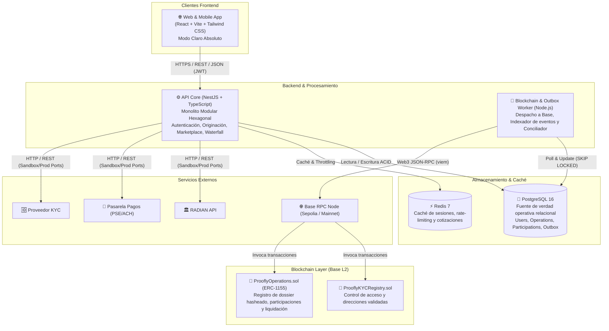
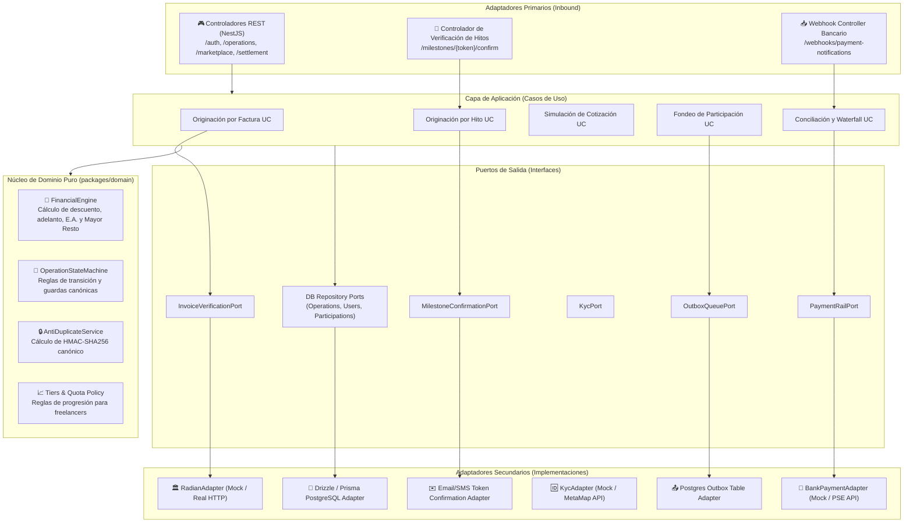

# Diagramas C4 de Arquitectura — Proofly (`docs/architecture/02-c4-diagrams.md`)

Este documento presenta los diagramas de arquitectura del sistema **Proofly** siguiendo el modelo C4 (Contexto, Contenedores y Componentes), representados formalmente mediante sintaxis estándar de Mermaid.

---

## 1. Nivel 1: Diagrama de Contexto de Sistema (System Context)

El diagrama de contexto ilustra la frontera del sistema Proofly, los actores humanos principales y los sistemas externos con los que se integra.

---

## 2. Nivel 2: Diagrama de Contenedores (Container Diagram)

El diagrama de contenedores descompone el sistema Proofly en sus aplicaciones desplegables, almacenes de datos y componentes de red.

---

## 3. Nivel 3: Diagrama de Componentes de la API Core (Component Diagram)

Detalla la organización interna hexagonal del contenedor `API Core`, separando Adaptadores Primarios (Inbound), Servicios de Aplicación, Núcleo de Dominio y Adaptadores Secundarios (Outbound).

