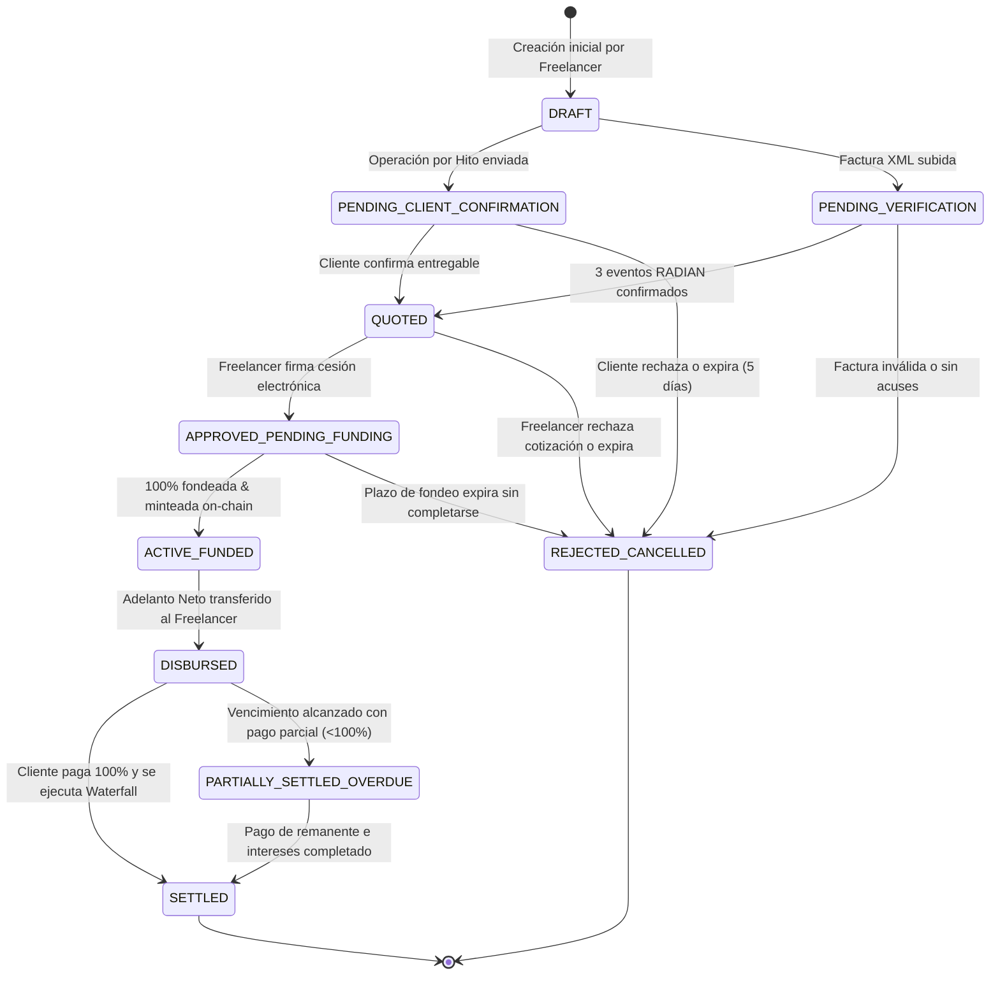

# Máquina de Estados Canónica — Proofly (`docs/architecture/04-state-machine.md`)

Este documento formaliza la **Máquina de Estados Canónica** que gobierna el ciclo de vida de toda operación en **Proofly**, tanto para facturas electrónicas como para hitos contractuales (*milestones*). Esta máquina garantiza consistencia estricta entre la base de datos PostgreSQL, los contratos inteligentes en Base y la interfaz de usuario.

---

## 1. Diagrama de Estados y Transiciones

---

## 2. Catálogo de Estados Canónicos

| # | Estado Canónico (`TypeScript`) | Equivalente Solidity (`enum`) | Etiqueta UI (Modo Claro) | Descripción Operativa |
| :-: | :--- | :--- | :--- | :--- |
| **1** | `DRAFT` | `Draft (0)` | `Borrador` | Operación en proceso de carga; aún no verificada ni cotizada. |
| **2** | `PENDING_CLIENT_CONFIRMATION` | `PendingConfirmation (1)` | `Esperando al Cliente` | Hito enviado; esperando que la empresa contratante confirme el entregable vía enlace. |
| **3** | `PENDING_VERIFICATION` | `PendingVerification (2)` | `Validando Factura` | Factura electrónica en proceso de consulta automática ante RADIAN/DIAN. |
| **4** | `QUOTED` | `Quoted (3)` | `Oferta Lista` | Oferta de adelanto y tasa calculada; esperando firma electrónica del freelancer. |
| **5** | `APPROVED_PENDING_FUNDING` | `OpenForFunding (4)` | `En Fondeo` | Cesión firmada; listada en el Marketplace para compra de participaciones. |
| **6** | `ACTIVE_FUNDED` | `Funded (5)` | `Fondeada` | Fondeo completado al 100 %; tokens ERC-1155 minteados en Base. |
| **7** | `DISBURSED` | `Disbursed (6)` | `Adelanto Pagado` | Capital neto transferido al banco del freelancer; esperando vencimiento de pago. |
| **8** | `SETTLED` | `Settled (7)` | `Liquidada` | Empresa pagó el 100 %; capital y ganancias distribuidos a financiadores. |
| **9** | `PARTIALLY_SETTLED_OVERDUE` | `OverduePartial (8)` | `En Mora / Pago Parcial` | Vencida con abono parcial o impago; cobranza activa y mora aplicándose. |
| **10**| `REJECTED_CANCELLED` | `Cancelled (9)` | `Cancelada / Rechazada` | Operación cancelada por vencimiento de oferta, rechazo o datos inválidos. |

---

## 3. Matriz de Transiciones y Guardas de Seguridad

| Estado Origen | Estado Destino | Evento Disparador | Actor Autorizado | Guardas y Condiciones Requeridas |
| :--- | :--- | :--- | :--- | :--- |
| `DRAFT` | `PENDING_CLIENT_CONFIRMATION` | `SUBMIT_MILESTONE` | Freelancer | Hito cuenta con entregable URL, valor nominal $> 0$ y fecha vencimiento válida. |
| `DRAFT` | `PENDING_VERIFICATION` | `SUBMIT_INVOICE` | Freelancer | Archivo XML UBL 2.1 parseable y CUFE extraído. |
| `PENDING_CLIENT_CONFIRMATION` | `QUOTED` | `CONFIRM_MILESTONE` | Empresa Contratante | Token de confirmación válido, vigente y sin uso previo. |
| `PENDING_VERIFICATION` | `QUOTED` | `RADIAN_VERIFIED` | Sistema (Worker) | Factura posee acuse de recibo, recibo de bienes y aceptación en RADIAN. |
| `QUOTED` | `APPROVED_PENDING_FUNDING` | `ACCEPT_AND_SIGN` | Freelancer | Firma electrónica válida de la cesión de derechos; cupo disponible verificado. |
| `APPROVED_PENDING_FUNDING` | `ACTIVE_FUNDED` | `FUNDING_COMPLETED`| Sistema (Worker) | Suma de participaciones $\equiv$ Capital a financiar ($K$); tx minteo confirmada on-chain. |
| `ACTIVE_FUNDED` | `DISBURSED` | `DISBURSEMENT_SUCCESS`| Sistema (PaymentPort) | Transferencia bancaria exitosa con ID de rastreo bancario confirmado. |
| `DISBURSED` | `SETTLED` | `FULL_PAYMENT_RECONCILED`| Operador / Webhook | Recaudo bancario $\ge$ Valor Nominal ($V_n$); Waterfall ejecutado en BD y Base. |
| `DISBURSED` | `PARTIALLY_SETTLED_OVERDUE` | `DUE_DATE_PASSED_PARTIAL`| Sistema (Scheduler) | Fecha actual $>$ Fecha de vencimiento y recaudo $< V_n$. |
| `PARTIALLY_SETTLED_OVERDUE` | `SETTLED` | `REMAINDER_RECONCILED` | Operador / Webhook | Saldo insoluto más intereses de mora cubiertos en su totalidad. |
| Cualquier estado previo a fondeo | `REJECTED_CANCELLED` | `CANCEL_OR_EXPIRE` | Freelancer / Sistema | No existen participaciones de financiadores comprometidas ni desembolsos. |

---

## 4. Estilos Visuales de Badges en la UI (Modo Claro Absoluto)

En cumplimiento estricto de [`docs/fuentes/DESIGN.md`](../fuentes/DESIGN.md), los estados se presentan en la interfaz con colores semánticos de alto contraste sobre fondo blanco o gris lavanda:

* **`En Fondeo` (Activo):** Fondo `#F8D4FD`, borde `#7300FF`, texto `#7300FF` en peso `600`.
* **`Liquidada` (Éxito Financiero):** Fondo `#DCFCE7`, texto `#16A34A` (Verde esmeralda).
* **`En Mora / Pago Parcial` (Alerta):** Fondo `#FFE4E6`, texto `#E11D48` (Rojo/Rosa de alerta).
* **`Esperando al Cliente` / `Validando Factura`:** Fondo `#F6F5F8`, texto `#52525B` con indicador pulsante.

