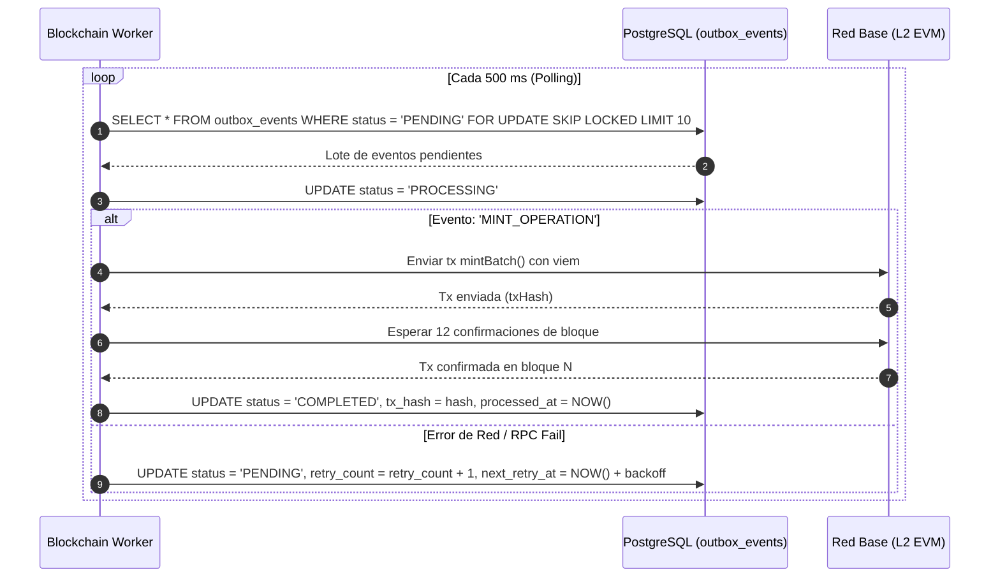

# Eventos de Dominio, Transactional Outbox y Consistencia Eventual — Proofly (`docs/architecture/07-events-consistency.md`)

Este documento especifica el catálogo de **Eventos de Dominio**, la arquitectura de **Transactional Outbox** y el protocolo de **Consistencia Eventual** entre la base de datos relacional (PostgreSQL) y la red blockchain (Base L2) en **Proofly**.

---

## 1. Catálogo de Eventos de Dominio (DDD)

Todos los eventos de dominio implementan la interfaz canónica `DomainEvent`:

```typescript
export interface DomainEvent<T = unknown> {
  eventId: string;          // UUID v4
  eventName: string;        // ej. 'operation.funding_completed'
  aggregateId: string;      // operationId o userId
  occurredAt: Date;
  payload: T;
  metadata: {
    correlationId: string;
    actorId: string;
    version: number;
  };
}
```

| Evento | Contexto Emisor | Disparador / Significado | Consumidores Principales |
| :--- | :--- | :--- | :--- |
| `OperationCreatedEvent` | Originación | Hito o factura subida por el freelancer | Reputation, Notifications |
| `MilestoneConfirmedEvent` | Originación | Empresa contratante valida hito vía enlace seguro | FinancialEngine, Notifications |
| `InvoiceRadianVerifiedEvent`| Originación | Acuses de factura validados ante RADIAN | FinancialEngine, Notifications |
| `CessionSignedEvent` | Originación | Freelancer firma cesión de derechos económicos | Marketplace, Notifications |
| `ParticipationFundedEvent` | Marketplace | Financiador adquiere una cuota parte de la operación | Marketplace, Notifications |
| `FundingCompletedEvent` | Marketplace | La operación alcanza el 100 % del fondeo necesario | Outbox (minteo on-chain), Notifications |
| `OperationMintedOnChainEvent`| Sincronización | Transacción `mintBatch` confirmada en Base | PaymentRail (ordenar desembolso) |
| `AdvanceDisbursedEvent` | Liquidación | Desembolso neto acreditado en la cuenta del freelancer | Originación, Notifications |
| `BankPaymentReceivedEvent` | Liquidación | Recaudo de la empresa recibido en cuenta fiduciaria | FinancialEngine (Waterfall), Outbox |
| `OperationSettledEvent` | Liquidación | Cascada ejecutada; saldos acreditados a financiadores | Outbox (settle on-chain), Notifications |
| `PartialPaymentRecordedEvent`| Liquidación | Abono parcial (< 100%) distribuido con Mayor Resto | Notifications, Cobranza |

---

## 2. Patrón Transactional Outbox

### 2.1. El Problema del Dual-Write
Si la API intentara escribir en PostgreSQL y simultáneamente enviar una transacción a la red Base mediante HTTP/RPC, un fallo de red o caída del proceso dejaría el sistema en un estado incoherente:
- BD dice que la operación está fondeada, pero la blockchain nunca emitió los tokens.
- O la transacción blockchain se mina con éxito, pero la BD hizo rollback.

### 2.2. Solución: Escritura Atómica en la Tabla `outbox_events`
Toda acción que requiera interacción con la blockchain o notificación asíncrona se guarda en la tabla `outbox_events` **dentro de la misma transacción ACID** de PostgreSQL que modifica el estado de la operación:

```sql
CREATE TABLE outbox_events (
    id UUID PRIMARY KEY DEFAULT gen_random_uuid(),
    aggregate_type VARCHAR(50) NOT NULL,
    aggregate_id VARCHAR(100) NOT NULL,
    event_type VARCHAR(100) NOT NULL,
    payload JSONB NOT NULL,
    status VARCHAR(20) NOT NULL DEFAULT 'PENDING', -- PENDING, PROCESSING, COMPLETED, FAILED
    retry_count INT NOT NULL DEFAULT 0,
    max_retries INT NOT NULL DEFAULT 5,
    next_retry_at TIMESTAMP WITH TIME ZONE DEFAULT CURRENT_TIMESTAMP,
    error_log TEXT,
    tx_hash VARCHAR(66),
    created_at TIMESTAMP WITH TIME ZONE DEFAULT CURRENT_TIMESTAMP,
    processed_at TIMESTAMP WITH TIME ZONE
);

CREATE INDEX idx_outbox_pending ON outbox_events(status, next_retry_at) WHERE status = 'PENDING';
```

---

## 3. Worker Asíncrono de Blockchain (`apps/worker`)

El proceso Worker opera mediante polling concurrente seguro utilizando `FOR UPDATE SKIP LOCKED` para evitar colisiones entre réplicas:



---

## 4. Garantía de Idempotencia y Tolerancia a Reorgs

### 4.1. Claves de Idempotencia
Cada llamada a `ChainGatewayPort` incluye una clave de idempotencia única derivada del `eventId` y el `canonicalHmac`. Si la transacción ya fue minada o enviada con el mismo nonce, el worker no genera una segunda transacción.

### 4.2. Tolerancia a Reorganizaciones de Bloques (*Chain Reorgs*)
En redes Layer 2 como Base, las reorganizaciones profundas son extremadamente raras pero posibles. Para blindar el sistema:
1. Ningún evento de liquidación o desembolso se considera irrevocable hasta alcanzar **12 confirmaciones de bloque** en Base.
2. El indexador almacena el `block_hash` además del `block_number`. Si el hash de un bloque previo cambia en una reindexación, el conciliador retrocede el puntero y revalida los eventos on-chain.

---

## 5. Servicio de Conciliación Diaria

A las 23:59 UTC, un cron job ejecuta la conciliación automática:
1. Suma el total de participaciones activas en PostgreSQL por operación.
2. Consulta el balance ERC-1155 del token correspondiente en el contrato `ProoflyOperations`.
3. Compara el saldo de la cuenta de recaudo fiduciaria contra los registros de liquidación.
4. Genera un reporte en `docs/reconciliation/` y emite una alerta si la discrepancia es mayor a $0 \text{ centavos}$.

