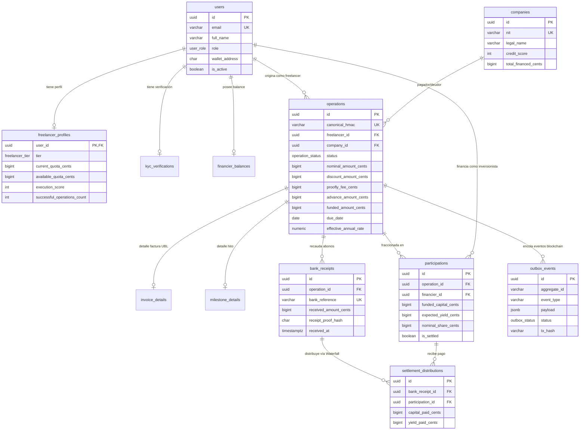

# Modelo de Datos Operacional (PostgreSQL) — Proofly (`docs/architecture/08-data-model.md`)

Este documento documenta la arquitectura relacional de **Proofly**, implementada en PostgreSQL 16 y disponible en [`db/schema.sql`](../../db/schema.sql). Está diseñada para garantizar consistencia transaccional ACID, precisión monetaria sin errores de redondeo y sincronización asíncrona con la red Base L2.

---

## 1. Diagrama Entidad-Relación (ERD) en Mermaid

---

## 2. Decisiones Clave del Modelo de Datos

### 2.1. Representación Monetaria en Centavos Enteros (`BIGINT`)
En cumplimiento de la **Invariante I9**, no existen columnas de tipo `FLOAT` ni `NUMERIC` para montos de dinero. Todas las cifras de capital, descuento, comisión y recaudo se almacenan en centavos de peso (`BIGINT`), garantizando exactitud contable absoluta:
- `$ 1.500.000 COP` se almacena como `150000000` (150 millones de centavos).

### 2.2. Clave Canónica Anti-Duplicado (`canonical_hmac`)
La columna `canonical_hmac VARCHAR(64)` en la tabla `operations` posee una restricción `UNIQUE`. El motor de PostgreSQL rechaza a nivel de base de datos cualquier intento de registrar una factura o hito con el mismo hash canónico, dando cumplimiento a la **Invariante I5**.

### 2.3. Herencia Funcional de Operaciones (Facturas vs. Hitos)
Se utiliza el patrón de tabla base (`operations`) con tablas de extensión 1:1 especializadas:
- `invoice_details`: CUFE, número de factura y banderas booleanas de los tres eventos RADIAN.
- `milestone_details`: UUID de contrato, índice del hito, enlace al entregable y token opaco de verificación para el cliente.

### 2.4. Tabla de Transactional Outbox
La tabla `outbox_events` almacena las operaciones pendientes de minteo, quema o liquidación on-chain. La inserción de estos registros ocurre en la misma transacción ACID de PostgreSQL que cambia el estado de la operación, garantizando entrega *at-least-once* sin inconsistencias de estado dual (*dual-write*).

