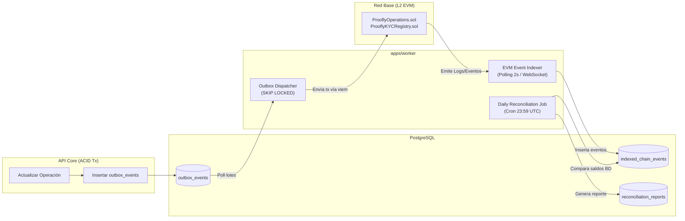

# Sincronización y Conciliación On-Chain/Off-Chain — Proofly (`docs/architecture/11-sync-and-reconciliation.md`)

Este documento especifica la arquitectura del **Worker de Outbox**, el **Indexador de Eventos EVM** y el **Motor de Conciliación Diaria** entre PostgreSQL y la red Base L2 en **Proofly**.

---

## 1. Arquitectura de Sincronización y Conciliación



---

## 2. Worker de Outbox (`Outbox Dispatcher`)

### 2.1. Algoritmo de Procesamiento Concurrente
Para permitir que múltiples instancias del worker procesen la cola sin colisiones ni condiciones de carrera, se ejecuta una consulta con bloqueo a nivel de fila:

```typescript
export async function fetchPendingOutboxBatch(client: PoolClient, batchSize: number = 10) {
  const query = `
    SELECT id, aggregate_id, event_type, payload, retry_count
    FROM outbox_events
    WHERE status = 'PENDING' AND next_retry_at <= NOW()
    ORDER BY created_at ASC
    LIMIT $1
    FOR UPDATE SKIP LOCKED;
  `;
  const result = await client.query(query, [batchSize]);
  return result.rows;
}
```

### 2.2. Política de Reintentos con Retroceso Exponencial (*Exponential Backoff*)
Si la llamada RPC falla por congestión, error de red o timeout:
$$\Delta t_{\text{reintento}} = \min(2^{\text{retry\_count}} \times 5 \text{ segundos}, 300 \text{ segundos})$$

Tras 5 reintentos fallidos, el evento pasa al estado `FAILED` y dispara una alerta crítica a PagerDuty / Datadog para intervención de soporte.

---

## 3. Indexador de Eventos EVM

### 3.1. Detección y Registro de Eventos
El indexador consulta periódicamente bloques finalizados en Base mediante `eth_getLogs`:
* Filtra eventos `OperationMinted` y `OperationSettled` de `ProoflyOperations`.
* Filtra eventos `KycStatusUpdated` de `ProoflyKYCRegistry`.
* Guarda los registros en `indexed_chain_events` validando la restricción de unicidad `(tx_hash, event_name, block_number)`.

### 3.2. Tolerancia a Reorganizaciones de Cadena (*Chain Reorgs*)
* El indexador mantiene una ventana de seguridad de **12 bloques de retraso** respecto al bloque más reciente de la red Base.
* En cada ciclo, verifica que el `block_hash` del bloque anterior coincida con el hash registrado en BD. Si se detecta un desacople por reorganización, el worker retrocede el puntero al último bloque canónico común y reindexa los eventos.

---

## 4. Motor de Conciliación Continua

A las 23:59 UTC de cada día, el sistema ejecuta la reconciliación automatizada de tres vías:
1. **Vía 1 (Base de Datos):** $\sum \text{participations.funded\_capital\_cents}$ por operación.
2. **Vía 2 (Blockchain Base):** Balance total del token ERC-1155 correspondiente en el contrato `ProoflyOperations`.
3. **Vía 3 (Bancos):** Extracto consolidado de la cuenta de recaudo fiduciaria vs. montos liquidados.

Cualquier diferencia mayor a **$0 \text{ centavos}$** bloquea automáticamente los desembolsos automáticos del día siguiente hasta que un operador audite el lote.

