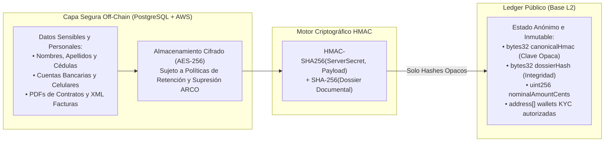

# Privacidad y Protección de Datos Personales (Ley 1581 de 2012) — Proofly (`docs/architecture/16-privacy-data-protection.md`)

Este documento define la arquitectura de privacidad por diseño de **Proofly**, alineada con el régimen estatutario de protección de datos personales en Colombia (**Ley 1581 de 2012**, Decretos Reglamentarios 1377 de 2013 y 1074 de 2015).

---

## 1. El Conflicto Blockchain vs. Privacidad de Datos y Solución Proofly

Las redes blockchain públicas como Base son por diseño **inmutables y transparentes**. Registrar información personal identificable (PII) —como nombres, números de cédula, correos o montos individuales— en un contrato inteligente vulnera flagrantemente el derecho al olvido, la rectificación y el principio de circulación restringida de la Ley 1581.

### La Solución: Principio de Privacidad On-Chain Estricta (Invariante I3)
Proofly establece una separación técnica y física absoluta entre datos operativos personales y el registro on-chain:

---

## 2. Garantías de los Derechos ARCO (Acceso, Rectificación, Cancelación, Oposición)

1. **Derecho de Supresión / Cancelación (Derecho al Olvido):**
   - Cuando un usuario solicita la eliminación de su cuenta conforme a la Ley 1581, sus datos personales (nombres, correos, cuentas bancarias) se eliminan o anonimizan irreversiblemente en PostgreSQL y en los repositorios de archivos.
   - Los hashes matemáticos (`bytes32`) que residen en la red Base permanecen on-chain para preservar la trazabilidad contable histórica, pero se vuelven matemáticamente disociados: al destruirse la información en el servidor, no existe correlación posible entre la persona física y el hash en la blockchain.
2. **Principio de Circulación Restringida:**
   - La información financiera del freelancer (facturas emitidas, clientes que le contratan) solo es visible para el freelancer y los operadores autorizados.
   - En el Marketplace, los financiadores ven únicamente identificadores opacos (ej. `Hito: Desarrollo Frontend React`), los scores de riesgo y los plazos, protegiendo el secreto comercial del profesional.

---

## 3. Estándares Técnicos de Seguridad y Cifrado

* **Cifrado en Tránsito:** TLS 1.3 con curvas elípticas seguras (ECDHE) y cabeceras HSTS forzadas (`Strict-Transport-Security: max-age=63072000; includeSubDomains; preload`).
* **Cifrado en Reposo:** Cifrado transparente de volúmenes de base de datos PostgreSQL mediante AES-256; campos altamente sensibles (ej. tokens de acceso o números de cuenta bancaria) cuentan con cifrado adicional a nivel de aplicación con claves gestionadas en AWS KMS.
* **Segregación de Ambientes:** Las bases de datos de desarrollo y Sandbox utilizan exclusivamente datos sintéticos ficticios generados programáticamente; está terminantemente prohibido utilizar volcados (*dumps*) de producción para pruebas.

