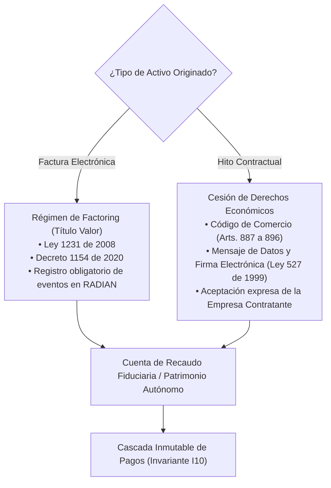

# Cumplimiento Regulatorio por Diseño — Proofly (`docs/architecture/17-compliance-by-design.md`)

Este documento establece las directrices jurídicas y controles técnicos automatizados que garantizan el estricto apego de **Proofly** al marco normativo mercantil, financiero y tributario de Colombia.

---

## 1. Régimen Jurídico Dual: Factoring vs. Cesión de Créditos Futuros

Proofly opera bajo dos figuras jurídicas perfectamente diferenciadas según el activo respaldante:



### 1.1. Facturación Electrónica como Título Valor (RADIAN)
Para calificar a la modalidad de factoring formal:
1. La factura electrónica debe ser emitida a crédito o con plazo de pago.
2. Deben constar en el RADIAN los tres acuses exigidos por la DIAN:
   - Acuse de recibo de la factura electrónica.
   - Constancia de recibo de los bienes o prestación de servicios.
   - Aceptación expresa (por el cliente) o aceptación tácita (tras 3 días hábiles sin reclamo formal).
3. **Control Técnico en Código:** Si `hasReceiptAcknowledgement`, `hasGoodsServicesReceived` o `hasExpressTacitAcceptance` es `false`, la operación no puede transicionar al estado `QUOTED`.

### 1.2. Hitos Contractuales como Cesión Electrónica de Créditos
Para contratos en ejecución antes de la emisión de la factura final:
1. El contrato de cesión de derechos económicos se firma electrónicamente por el freelancer utilizando métodos conformes al Decreto 2364 de 2012 (firma electrónica confiable y apropiada).
2. Se requiere la aceptación verificable del cliente mediante token de confirmación criptográfico.

---

## 2. Blindaje Frente a la Captación Masiva e Ilegal

Para no incurrir en la conducta tipificada en el artículo 316 del Código Penal y el Decreto 1981 de 1988:
* **Asignación Específica de Riesgo:** Cada token ERC-1155 representa derechos económicos sobre **una operación concreta**. Los financiadores no depositan dinero en un fondo ciego ni reciben rendimientos garantizados globales; eligen a qué freelancer/hito fondear y asumen el riesgo de solvencia de dicho deudor.
* **Sin Pasivos Financieros con el Público:** Proofly no capta ahorro del público para intermediarlo como crédito propio; actúa como facilitador tecnológico y mandatario de recaudo.
* **Cuentas de Recaudo Controladas:** Los pagos se canalizan mediante cuentas de recaudo fiduciario o convenios bancarios específicos con segregación patrimonial.

---

## 3. Límite Legal de Usura (Superintendencia Financiera)

* **Control en el Motor Financiero:** Antes de emitir cualquier cotización, el `FinancialEngine` calcula la Tasa Efectiva Anual ($E.A.$) resultante del descuento comercial y las comisiones.
* **Guarda de Seguridad:** La tasa E.A. se valida programáticamente contra el parámetro global `MAX_LEGAL_USURY_RATE_BPS`. Si la tasa supera dicho límite, el descuento se ajusta automáticamente a la baja para mantenerse estrictamente dentro de la legalidad:

```typescript
if (effectiveAnnualRateBps > currentUsuryRateBps) {
  effectiveAnnualRateBps = currentUsuryRateBps;
  // Recalcular descuento comercial a la tasa tope
}
```

---

## 4. Transparencia y Advertencias Obligatorias en la Interfaz (UI)

De conformidad con los principios de transparencia de la Superintendencia de Industria y Comercio (SIC):
1. Toda tarjeta de simulación de participación para el financiador debe desglosar:
   - Capital aportado en COP.
   - Ganancia estimada en COP.
   - Tasa Efectiva Anual ($E.A.$) equivalente.
   - Plazo exacto en días naturales y fecha de vencimiento.
2. Texto de advertencia visible y de alto contraste en el checkout:  
   > *"Esta operación no constituye un depósito de ahorro bancario ni cuenta con seguro de Fogafín. La rentabilidad está sujeta al cumplimiento en el pago por parte de la empresa contratante."*

