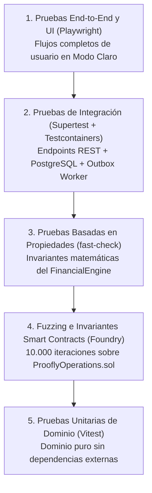

# Estrategia de Calidad y Suite de Pruebas (QA-01 a QA-06) — Proofly (`docs/architecture/19-quality-strategy.md`)

Este documento especifica la estrategia integral de aseguramiento de calidad (QA), pirámide de pruebas y definición detallada de las pruebas maestras de aceptación **QA-01 a QA-06** en **Proofly**.

---

## 1. Pirámide de Pruebas y Herramientas

---

## 2. Pruebas Basadas en Propiedades (*Property-Based Testing*)

Para el motor financiero (`FinancialEngine`), las pruebas unitarias basadas en ejemplos fijos son insuficientes. Se utiliza `fast-check` para validar invariantes universales sobre millones de combinaciones aleatorias:

1. **Invariante de Conservación de Masa Financiera:**
   $$\forall V_n, d, C_p: \quad A + D_{\text{total}} + C_p \equiv V_n$$
2. **Invariante del Mayor Resto:**
   $$\forall \text{MontoTotal}, \forall \text{Pesos}: \quad \sum_{i=1}^k \text{allocatedCents}_i \equiv \text{MontoTotal}$$
3. **Invariante de Tasa Positiva:**
   $$\forall n \in [15, 90], \forall r_m > 0: \quad E.A. > 0$$

---

## 3. Especificación de Pruebas Maestras QA-01 a QA-06

### QA-01: Onboarding y Asignación de Cupo Tier 1 (Semilla)
* **Objetivo:** Verificar que un freelancer recién verificado acceda a Tier 1 con un cupo semilla de $ 2.000.000 COP sin historial previo.
* **Flujo:** Registro de usuario $\rightarrow$ Verificación KYC vía `KycPort` $\rightarrow$ Comprobación de asignación de `freelancer_tier = 'TIER_1_SEED'` y `available_quota_cents = 200000000`.
* **Criterio de Éxito:** Estado `VERIFIED`, cupo inicial disponible exacto de $ 2.000.000 COP y dirección wallet vinculada.

### QA-02: Originación por Factura Electrónica y Consulta RADIAN
* **Objetivo:** Validar el flujo de carga de factura UBL 2.1 y la exigencia de los tres eventos normativos del RADIAN.
* **Flujo:** Carga de archivo XML $\rightarrow$ Extracción de CUFE y montos $\rightarrow$ Consulta ante `InvoiceVerificationPort` $\rightarrow$ Cálculo de cotización.
* **Criterio de Éxito:** Si faltan acuses, estado pasa a `REJECTED_CANCELLED`; si los tres acuses están presentes, transiciona a `QUOTED` con desglose exacto de adelanto en COP.

### QA-03: Originación por Hito Contractual y Confirmación de Cliente
* **Objetivo:** Validar la confirmación sin fricción del hito por parte de la empresa contratante.
* **Flujo:** Freelancer crea hito con entregable URL $\rightarrow$ Sistema genera token criptográfico y envía notificación $\rightarrow$ Cliente invoca `/api/v1/milestones/{token}/confirm`.
* **Criterio de Éxito:** Operación avanza a `QUOTED`; el token de confirmación queda invalidado para usos posteriores (un solo uso).

### QA-04: Fondeo Fraccionado en Marketplace y Emisión ERC-1155
* **Objetivo:** Validar que múltiples financiadores completen el 100 % del capital y el worker despache el minteo on-chain.
* **Flujo:** Financiador A aporta el 60 % y Financiador B el 40 % $\rightarrow$ Operación alcanza el 100 % $\rightarrow$ Estado `FUNDED_PENDING_MINT` $\rightarrow$ Worker ejecuta `mintOperation` en Base.
* **Criterio de Éxito:** Tokens ERC-1155 minteados en Base con balances exactos asignados a las wallets de A y B; suma de balances $\equiv V_n$.

### QA-05: Recaudo Bancario Completo y Liquidación Waterfall
* **Objetivo:** Verificar que el pago del 100 % del valor nominal liquide la operación sin pérdida de centavos.
* **Flujo:** Operador registra comprobante bancario por $V_n$ $\rightarrow$ Se ejecuta Cascada Waterfall $\rightarrow$ Se acreditan capital y ganancias a financiadores $\rightarrow$ Contrato inteligente ejecuta `settleOperation`.
* **Criterio de Éxito:** Operación pasa a `SETTLED`; $\sum \text{pagos} = V_n$; balance de financiadores incrementado en capital + rendimiento pactado.

### QA-06: Recaudo Parcial (60%) y Distribución por Mayor Resto
* **Objetivo:** Probar el caso crítico de incumplimiento parcial con reparto asimétrico de centavos.
* **Flujo:** Operación de $ 10.000.000 COP fondeada por 3 financiadores (1/3 c/u) $\rightarrow$ Empresa abona solo el 60 % ($ 6.000.000 COP).
* **Criterio de Éxito:** Cada financiador recibe exactamente `$ 2.000.000 COP` ($200.000.000 \text{ centavos}$) sin pérdida de centavos; estado pasa a `PARTIALLY_SETTLED_OVERDUE` para cobranza de mora sobre el 40 % restante.

