# Entornos, Configuración y Pipeline CI/CD — Proofly (`docs/architecture/20-environments-ci-cd.md`)

Este documento especifica la matriz de configuración de variables de entorno tipadas y el pipeline de integración y despliegue continuo (CI/CD) de **Proofly**, dando estricto cumplimiento a la **Invariante I2 (Arquitectura Multi-Entorno por Configuración)**.

---

## 1. Validación de Configuración al Arranque (Zod Schema)

Toda la configuración del sistema se valida de forma estricta durante el arranque del proceso en `apps/api` y `apps/worker`. Si alguna variable requerida falta o tiene un formato inválido, el contenedor detiene su ejecución inmediatamente con un mensaje de diagnóstico explícito:

```typescript
import { z } from 'zod';

export const EnvSchema = z.object({
  NODE_ENV: z.enum(['development', 'test', 'production']),
  ENV_MODE: z.enum(['sandbox', 'production']),
  PORT: z.coerce.number().default(3000),
  
  // Base de datos y caché
  DATABASE_URL: z.string().url(),
  REDIS_URL: z.string().url(),
  
  // Seguridad y Criptografía
  SERVER_HMAC_SECRET: z.string().min(32),
  JWT_SECRET: z.string().min(32),
  
  // Red Blockchain Base
  CHAIN_ID: z.coerce.number(), // 84532 para Sepolia, 8453 para Mainnet
  RPC_URL: z.string().url(),
  PROOFLY_OPERATIONS_ADDRESS: z.string().regex(/^0x[a-fA-F0-9]{40}$/),
  PROOFLY_KYC_REGISTRY_ADDRESS: z.string().regex(/^0x[a-fA-F0-9]{40}$/),
  OPERATOR_PRIVATE_KEY: z.string().min(64),
  
  // Adaptadores de Dominio
  INVOICE_ADAPTER: z.enum(['mock', 'dian_http']),
  MILESTONE_ADAPTER: z.enum(['console', 'sendgrid']),
  KYC_ADAPTER: z.enum(['mock', 'truora']),
  PAYMENT_ADAPTER: z.enum(['memory', 'wompi_pse'])
});

export type EnvConfig = z.infer<typeof EnvSchema>;
```

---

## 2. Matriz Comparativa de Entornos

| Variable | Entorno Sandbox (Pruebas) | Entorno Producción |
| :--- | :--- | :--- |
| `ENV_MODE` | `sandbox` | `production` |
| `CHAIN_ID` | `84532` (Base Sepolia) | `8453` (Base Mainnet) |
| `RPC_URL` | `https://sepolia.base.org` | `https://mainnet.base.org` (o nodo privado) |
| `INVOICE_ADAPTER` | `mock` (`MockRadianAdapter`) | `dian_http` (`DianRadianHttpAdapter`) |
| `MILESTONE_ADAPTER`| `console` (`ConsoleMailMilestoneAdapter`) | `sendgrid` (`SendGridSmsMilestoneAdapter`) |
| `KYC_ADAPTER` | `mock` (`DeterministicMockKycAdapter`) | `truora` (`TruoraKycAdapter`) |
| `PAYMENT_ADAPTER` | `memory` (`MemoryPaymentRailAdapter`) | `wompi_pse` (`WompiPsePaymentAdapter`) |
| **Badge en UI** | *"Entorno de Pruebas (Base Sepolia)"* | *Ninguno (Producción)* |

---

## 3. Pipeline de CI/CD (GitHub Actions)

```mermaid
flowchart LR
    Commit["git push / PR"] --> Lint["1. Lint & Format<br>(ESLint, Prettier, Solhint)"]
    Lint --> Typecheck["2. TypeScript Typecheck<br>(tsc --noEmit)"]
    Typecheck --> Tests["3. Unit & Property Tests<br>(Vitest + fast-check)"]
    Tests --> Foundry["4. Smart Contracts<br>(forge test --fuzz-runs 10000)"]
    Foundry --> Build["5. Docker Build<br>(Turborepo prune + multi-stage)"]
    Build --> Scan["6. Security Scan<br>(Trivy + Slither)"]
    Scan --> Deploy["7. Despliegue Automatizado<br>(AWS ECS / Railway / Base)"]
```



* **Puerta de Calidad Bloqueante:** Ningún PR puede fusionarse a `main` si la cobertura de pruebas de dominio en `packages/domain` es inferior al **95 %** o si Slither reporta vulnerabilidades de severidad alta o media en los contratos Solidity.

