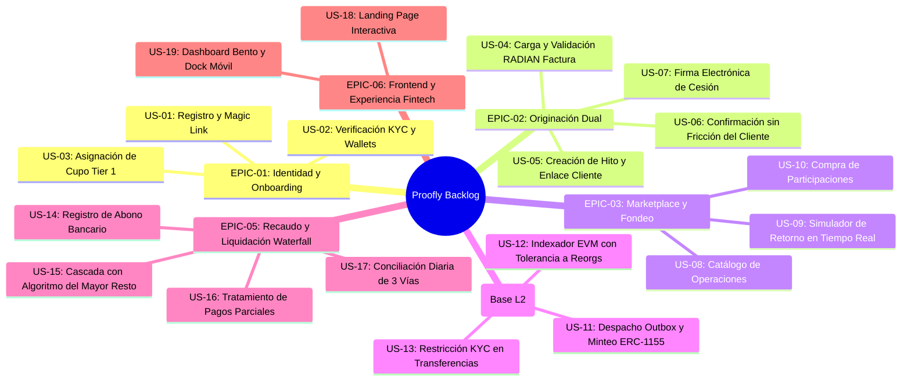

# Backlog Priorizado de Producto y Desarrollo — Proofly (`docs/plan/backlog.md`)

Este documento contiene el backlog priorizado de Épicas e Historias de Usuario para el desarrollo de **Proofly**, estructurado con Criterios de Aceptación (Gherkin/DoD) verificables.

---

## 1. Mapa de Épicas del Proyecto

---

## 2. Historias de Usuario Detalladas

### Épica 1: Identidad, Onboarding y Cupos
* **US-01: Registro con Correo y Magic Link**
  - *Como:* Freelancer o Financiador.
  - *Quiero:* Registrarme e iniciar sesión con mi correo electrónico sin contraseñas complejas.
  - *Criterio de Aceptación:* El sistema despacha un Magic Link seguro con validez de 15 minutos; al hacer clic, se autentica la sesión y se emite un JWT.
* **US-02: Verificación Biométrica KYC y Generación de Wallet**
  - *Como:* Usuario registrado.
  - *Quiero:* Validar mi identidad con mi cédula y una selfie.
  - *Criterio de Aceptación:* El `KycPort` verifica antecedentes; si es aprobado, el usuario pasa a `VERIFIED` y se le asigna una wallet abstraída en Base L2.
* **US-03: Asignación de Cupo Tier 1 (Semilla)**
  - *Como:* Freelancer verificado sin historial en la plataforma.
  - *Quiero:* Conocer mi cupo inicial disponible para financiar mi primer trabajo.
  - *Criterio de Aceptación:* El sistema le otorga inmediatamente el Tier 1 con un cupo semilla de $ 2.000.000 COP sin requerir garantías previas.

---

### Épica 2: Motor de Originación Dual
* **US-04: Carga de Factura Electrónica y Consulta RADIAN**
  - *Como:* Freelancer con factura emitida.
  - *Quiero:* Subir el XML UBL 2.1 de mi factura para recibir una oferta de adelanto.
  - *Criterio de Aceptación:* El sistema extrae el CUFE y verifica los tres acuses normativos ante RADIAN; si es válida, calcula el adelanto neto al instante en COP.
* **US-05: Creación de Hito Contractual y Notificación al Cliente**
  - *Como:* Freelancer trabajando por contratos o entregables.
  - *Quiero:* Registrar un hito con entregable URL y correo de mi cliente.
  - *Criterio de Aceptación:* El sistema genera una clave canónica HMAC, guarda el hito en `PENDING_CLIENT_CONFIRMATION` y despacha un correo con enlace seguro al cliente.
* **US-06: Confirmación del Hito por la Empresa Contratante**
  - *Como:* Representante de la empresa cliente.
  - *Quiero:* Aprobar el entregable del freelancer mediante un enlace sin crear cuenta.
  - *Criterio de Aceptación:* Al abrir `/verify/[token]` y hacer clic en confirmar, la operación transiciona a `QUOTED` y el token queda invalidado para usos futuros.
* **US-07: Firma Electrónica de Cesión de Derechos**
  - *Como:* Freelancer con oferta lista.
  - *Quiero:* Firmar electrónicamente la cesión de derechos para que mi operación pase a fondeo.
  - *Criterio de Aceptación:* Se registra el consentimiento con hash de dossier; la operación pasa a `APPROVED_PENDING_FUNDING` y se publica en el Marketplace.

---

### Épica 3: Marketplace y Fondeo
* **US-08: Exploración de Operaciones Disponibles**
  - *Como:* Financiador con KYC activo.
  - *Quiero:* Ver la lista de facturas e hitos abiertos a financiación con scores y plazos.
  - *Criterio de Aceptación:* El catálogo muestra título opaco, Score de Ejecución del Freelancer, Score de la Empresa, plazo en días y Tasa E.A. ofrecida.
* **US-09: Simulador de Rendimiento en Tiempo Real**
  - *Como:* Financiador evaluando una operación.
  - *Quiero:* Ingresar el monto que deseo aportar y ver mi ganancia exacta en pesos (COP).
  - *Criterio de Aceptación:* Al mover el control de monto, la interfaz calcula al instante: capital a aportar, ganancia neta en COP y fecha estimada de cobro.
* **US-10: Compra de Participaciones Fraccionadas**
  - *Como:* Financiador.
  - *Quiero:* Confirmar mi aporte con cargo a mi saldo disponible.
  - *Criterio de Aceptación:* En una transacción atómica se bloquea el cupo, se descuenta el saldo y se crea el registro de participación.

---

### Épica 4: Blockchain y Outbox (Base L2)
* **US-11: Despacho Outbox y Minteo ERC-1155**
  - *Como:* Sistema.
  - *Quiero:* Mintear las participaciones on-chain cuando una operación se fondea al 100 %.
  - *Criterio de Aceptación:* El worker lee el outbox con `SKIP LOCKED`, invoca `mintOperation` en `ProoflyOperations` y emite los tokens a las wallets autorizadas.
* **US-12: Indexador EVM con Tolerancia a Reorgs**
  - *Como:* Sistema.
  - *Quiero:* Registrar los eventos confirmados de la blockchain en la base de datos local.
  - *Criterio de Aceptación:* El indexador espera 12 bloques de finalidad en Base antes de marcar cualquier evento como definitivo.
* **US-13: Restricción de Cumplimiento en Transferencias On-Chain**
  - *Como:* Oficial de cumplimiento.
  - *Quiero:* Que los tokens no puedan transferirse a direcciones sin KYC.
  - *Criterio de Aceptación:* El hook `_update` del contrato Solidity revierte cualquier transferencia hacia o desde cuentas que no estén activas en `ProoflyKYCRegistry`.

---

### Épica 5: Recaudo y Liquidación Waterfall
* **US-14: Registro de Recaudo Bancario**
  - *Como:* Operador de Proofly.
  - *Quiero:* Registrar el ingreso de fondos recibido de la empresa contratante.
  - *Criterio de Aceptación:* Se almacena la referencia bancaria y el hash del extracto, validando que el monto cubra el valor nominal adeudado.
* **US-15: Cascada de Pagos con Algoritmo del Mayor Resto**
  - *Como:* Financiador.
  - *Quiero:* Recibir mi capital y rendimientos pactados en mi balance al liquidarse la operación.
  - *Criterio de Aceptación:* El `FinancialEngine` distribuye el recaudo sin perder un solo centavo de residuo decimal; la operación pasa a `SETTLED`.
* **US-16: Liquidación Pro-Rata en Pagos Parciales**
  - *Como:* Financiador.
  - *Quiero:* Que ante un pago parcial se me reembolse prioritariamente mi capital en proporción exacta.
  - *Criterio de Aceptación:* El sistema prorratea el monto recibido con el Algoritmo del Mayor Resto y coloca el saldo insoluto en estado de mora.
* **US-17: Conciliación Diaria de 3 Vías**
  - *Como:* Auditor del protocolo.
  - *Quiero:* Un proceso diario que compare saldos de BD, tokens ERC-1155 y extractos bancarios.
  - *Criterio de Aceptación:* El job de las 23:59 UTC emite un reporte con cero discrepancias o dispara una alerta P1 si la diferencia es $> 0 \text{ centavos}$.

---

### Épica 6: Frontend y Experiencia Fintech (Modo Claro Absoluto)
* **US-18: Landing Page Interactiva de Alto Impacto**
  - *Como:* Visitante.
  - *Quiero:* Entender la propuesta de valor dual de Proofly en una navegación moderna y fluida.
  - *Criterio de Aceptación:* Hero section con tarjetas polaroid flotantes, carrusel horizontal Bento 01-06 y cumplimiento estricto de las directivas de `design-taste-frontend`.
* **US-19: Dashboard Bento y Navegación Móvil**
  - *Como:* Usuario móvil.
  - *Quiero:* Gestionar mis operaciones con tarjetas Bento limpias y dock flotante táctil.
  - *Criterio de Aceptación:* Interfaz 100 % Modo Claro (`#FFFFFF`, `#F8D4FD`, `#000000`, `#7300FF`), botones en píldora y cero desbordamientos en pantallas de 320px a 430px.

