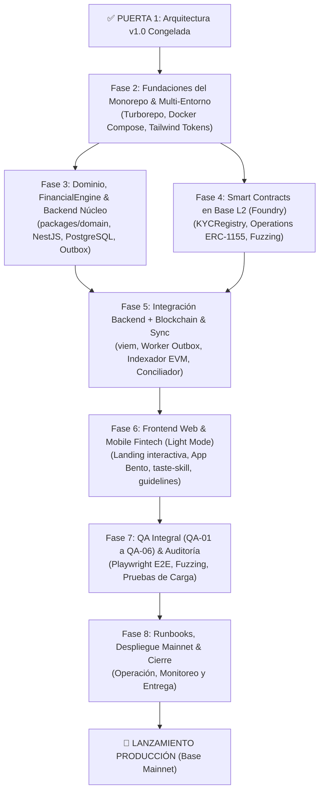

# Plan Maestro de Construcción (Fases 2 a 8) — Proofly (`docs/plan/build-plan.md`)

Este documento define la hoja de ruta operativa, dependencias técnicas, criterios de salida y cronograma para la construcción de la plataforma **Proofly**, tras el cierre formal de la Arquitectura v1.0 en la **Puerta 1**.

---

## 1. Visión General del Plan de Construcción

---

## 2. Desglose Fase por Fase

### Fase 2: Fundaciones del Monorepo y Entorno Multi-Red
* **Objetivo:** Establecer la infraestructura de código, empaquetado y tipado base del monorepo.
* **Entregables:**
  - Estructura Turborepo: `apps/web`, `apps/api`, `apps/worker`, `packages/domain`, `packages/contracts-sdk`, `contracts/`.
  - `docker-compose.yml` con PostgreSQL 16 (extensiones UUID y pgcrypto) y Redis 7.
  - Configuración base de Tailwind CSS con tokens de Proofly (`#FFFFFF`, `#F8D4FD`, `#000000`, `#7300FF`, `#F6F5F8`).
  - Validación de configuración con Zod (`EnvSchema`).
* **Criterio de Salida:** `turbo run build` y `turbo run test` ejecutan en limpio en un entorno nuevo.

### Fase 3: Dominio, Motor Financiero y Backend Núcleo
* **Objetivo:** Implementar la lógica pura de negocio en TypeScript y la API REST en NestJS.
* **Entregables:**
  - `packages/domain`: `FinancialEngine` con Algoritmo del Mayor Resto y tests basados en propiedades (`fast-check`), máquina de estados canónica de 10 estados y servicio `AntiDuplicateService` HMAC.
  - `apps/api`: Módulos NestJS por Bounded Context, repositorios con Drizzle/Prisma sobre PostgreSQL y patrón Transactional Outbox.
  - Implementación de adaptadores de prueba (*sandbox*) para todos los puertos.
* **Criterio de Salida:** Suite de pruebas unitarias y de propiedades al 100 %; endpoints de cotización y originación respondiendo con precisión de centavos.

### Fase 4: Contratos Inteligentes en Base L2 (Foundry)
* **Objetivo:** Desarrollar, auditar y probar la capa on-chain en Solidity 0.8.24+.
* **Entregables:**
  - `ProoflyKYCRegistry.sol`: Control de acceso y lista blanca.
  - `ProoflyOperations.sol`: ERC-1155 restringido con hook de verificación KYC, registro HMAC y liquidación.
  - Suite Foundry: pruebas unitarias, tests de fuzzing (10.000 iteraciones) e invariantes de suministro y anti-duplicado.
  - Scripts de despliegue parametrizados para Base Sepolia y Base Mainnet.
* **Criterio de Salida:** Cero errores en Slither y todas las invariantes de Foundry verificadas en verde.

### Fase 5: Integración Backend + Blockchain y Conciliación
* **Objetivo:** Conectar el backend con la red Base de forma asíncrona y tolerante a fallos.
* **Entregables:**
  - `apps/worker`: Poller de `outbox_events` con `SKIP LOCKED` y cliente `viem`.
  - Indexador de eventos EVM con ventana de seguridad de 12 bloques.
  - Cron job de conciliación diaria de tres vías (BD, Blockchain, Banco).
* **Criterio de Salida:** Flujo continuo desde la compra de participación en API hasta el minteo confirmado en Base Sepolia sin atascos de gas.

### Fase 6: Frontend Web & Mobile Fintech (Modo Claro Absoluto)
* **Objetivo:** Construir la experiencia de usuario completa aplicando las skills instaladas y la identidad de marca de Proofly.
* **Entregables:**
  - **Landing Page Interactiva:** Scroll de alto impacto, hero con polaroids flotantes y carrusel Bento 01-06.
  - **Web & Mobile App Fintech:**
    - Onboarding y visualización de cupo Tier 1.
    - Flujo de originación en 3 pasos para freelancers (factura o hito).
    - Portal sin fricción para confirmación de clientes (`/verify/[token]`).
    - Dashboard y Marketplace de financiadores con tarjetas Bento (gráfico de barras `#7300FF` + card lavanda `#F8D4FD`).
    - Simulador interactivo de checkout en tiempo real.
    - Portafolio y retiro de rendimientos.
  - **Alineación con Skills:** Validado por `design-taste-frontend` (anti-slop, micro-interacciones, fotografía real) y auditado por `web-design-guidelines`.
* **Criterio de Salida:** 0 errores de desbordamiento horizontal en 320px/390px/430px; contraste WCAG 2.1 AA en todas las pantallas.

### Fase 7: Validación Integral (QA-01 a QA-06), Seguridad y Pruebas de Carga
* **Objetivo:** Ejecutar la suite de pruebas maestras automatizadas de punta a punta.
* **Entregables:**
  - Automatización Playwright de los flujos QA-01 a QA-06.
  - Pruebas de carga con k6 simulando picos de 200 req/s.
  - Escaneo de seguridad estática y dinámica.
* **Criterio de Salida:** Las 6 pruebas maestras pasando en verde en CI/CD; $p95 < 150 \text{ ms}$ bajo carga.

### Fase 8: Documentación Operativa, Runbooks de Producción y Lanzamiento
* **Objetivo:** Preparar la operación productiva y el manual de conmutación a Mainnet.
* **Entregables:**
  - Runbooks operativos de conciliación, resolución de atascos de gas y gestión de mora.
  - Procedimiento de cambio de variables de entorno para pasar a Base Mainnet (`CHAIN_ID=8453`).
  - Entrega final del repositorio limpio y paquetizado.
* **Criterio de Salida:** Despliegue verificado en producción con contratos desplegados en Base Mainnet.

