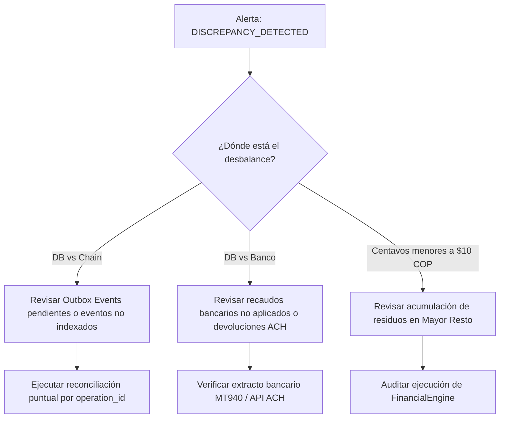

# Runbook 01: Protocolo ante Descuadres en la Conciliación Diaria (`docs/runbooks/RUNBOOK-01-RECONCILIATION-INCIDENTS.md`)

**Código de Incidente:** `INC-REC-01`  
**Severidad:** Crítica (P1 si discrepancia $> \$0\text{ COP}$, P2 si demora en conciliación)  
**Sistemas Afectados:** Worker Asíncrono (`apps/worker`), Base de Datos PostgreSQL (`operations`, `participations`), Smart Contract Base L2 (`ProoflyOperations.sol`), Cuenta Bancaria Concentradora (ACH / PSE).

---

## 1. Resumen Ejecutivo y Disparadores

Proofly ejecuta un proceso diario de conciliación tripartita a las 23:59:00 UTC (`DailyReconciliationJob`). El trabajo contrasta tres fuentes de verdad independientes:
1. **Libro Mayor PostgreSQL:** Saldo acumulado de capital y liquidaciones en centavos enteros (`nominal_amount_cents`, `settled_amount_cents`).
2. **Libro Mayor On-Chain (Base L2):** Estado de suministros ERC-1155 en `ProoflyOperations.sol` (`balanceOf`, `isSettled`, `totalSettledCents`).
3. **Libro Mayor Bancario:** Extracto bancario consolidado del banco recaudador (vía webhook de dispersión ACH / API bancaria).

### Disparadores de Alerta
- **`DISCREPANCY_DETECTED`:** Discrepancia aritmética entre cualquiera de los 3 libros superior a $\$0\text{ COP}$ ($0$ centavos).
- **`CONCILIATION_JOB_FAILED`:** El worker no pudo consultar el RPC de Base L2 o la base de datos dentro de la ventana límite de 15 minutos.

---

## 2. Diagrama de Diagnóstico Rápido



---

## 3. Protocolo de Acción Paso a Paso

### Paso 1: Notificación y Congelamiento Preventivo
1. Notificar en el canal `#ops-alerts` de incidentes financieros.
2. Si la discrepancia supera los $\$5.000.000\text{ COP}$, activar el congelamiento de dispersiones automáticas:
   ```bash
   # Pausar worker de dispersión ACH temporalmente
   npm run worker:pause -- --queue=ach-disbursements
   ```

### Paso 2: Triangulación de Balances
Ejecutar la consulta forense en PostgreSQL para identificar las operaciones con diferencias:

```sql
SELECT 
    o.id AS operation_id,
    o.code,
    o.status,
    o.nominal_amount_cents,
    o.funded_capital_cents,
    o.settled_amount_cents,
    COALESCE(SUM(p.funded_amount_cents), 0) AS total_participations_cents,
    (o.funded_capital_cents - COALESCE(SUM(p.funded_amount_cents), 0)) AS delta_participations
FROM operations o
LEFT JOIN participations p ON o.id = p.operation_id
GROUP BY o.id
HAVING o.funded_capital_cents <> COALESCE(SUM(p.funded_amount_cents), 0);
```

### Paso 3: Verificación On-Chain (Base L2)
Obtener el estado on-chain del token ERC-1155 correspondiente al `operation_id`:

```bash
# Consultar estado de la operación en Base L2
cast call $PROOFLY_OPERATIONS_ADDRESS \
  "getOperation(uint256)(uint256,uint256,bytes32,bool)" \
  $OPERATION_NUMERIC_ID \
  --rpc-url $BASE_RPC_URL
```

Comparar los valores obtenidos:
- `nominalAmountCents`: Debe coincidir exactamente con `operations.nominal_amount_cents`.
- `totalSettledCents`: Debe coincidir exactamente con `operations.settled_amount_cents`.
- `isSettled`: Debe coincidir con el estado `SETTLED` en PostgreSQL.

### Paso 4: Causas Comunes y Remediación

#### Causa A: Evento de Outbox Atascado o Fallido
- **Síntoma:** PostgreSQL tiene estado `FUNDED`, pero no hay transacción de minteo en Base L2.
- **Remediación:**
  ```sql
  -- Verificar eventos en estado FAILED
  SELECT id, event_type, payload, retry_count, last_error 
  FROM outbox_events 
  WHERE status = 'FAILED' AND aggregate_id = '<OPERATION_ID>';
  
  -- Reintentar evento tras solucionar conectividad RPC
  UPDATE outbox_events 
  SET status = 'PENDING', retry_count = 0, next_retry_at = NOW() 
  WHERE id = '<EVENT_ID>';
  ```

#### Causa B: Reorganización Profunda de Bloques en Base L2 ($> 12$ bloques)
- **Síntoma:** El indexador de eventos procesó un bloque que luego fue huérfano.
- **Remediación:**
  ```bash
  # Forzar re-indexación desde bloque seguro confirmado
  npm run worker:reindex -- --from-block=<BLOCK_NUMBER_MINUS_50>
  ```

#### Causa C: Recaudo Bancario Duplicado o Extemporáneo
- **Síntoma:** El cliente pagó dos veces la misma factura o pagó un monto superior al nominal.
- **Remediación:**
  1. No ejecutar liquidación en cascada sobre el excedente.
  2. Registrar el saldo a favor en la tabla de pasivos por devolución (`reimbursements`).
  3. Emitir orden de reintegro a la cuenta origen del pagador corporativo.

---

## 4. Cierre del Incidente y Post-Mortem

1. Ejecutar nuevamente la suite de conciliación para validar discrepancia $\$0\text{ COP}$:
   ```bash
   npm run test -- apps/worker/src/jobs/daily-reconciliation.test.ts
   ```
2. Reanudar el worker de dispersión si fue pausado.
3. Documentar en `docs/incident-reports/` con:
   - Causa raíz (Root Cause Analysis - RCA).
   - Monto en centavos del desbalance y tiempo de resolución.
   - Acciones preventivas para el motor de conciliación.

