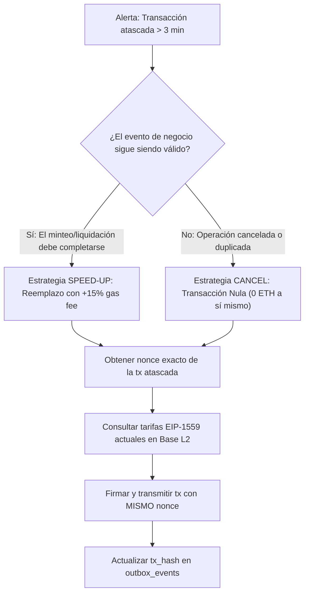

# Runbook 02: Reemplazo y Desatasco de Transacciones en Base L2 (`docs/runbooks/RUNBOOK-02-GAS-STUCK-TRANSACTIONS.md`)

**Código de Incidente:** `INC-GAS-02`  
**Severidad:** Alta (P2)  
**Sistemas Afectados:** Worker Asíncrono (`apps/worker`), Transaccional Outbox (`outbox_events`), Billetera Operadora (Operator Key), Base L2 (`ProoflyOperations.sol`).

---

## 1. Resumen Ejecutivo y Disparadores

El `OutboxDispatcher` despacha transacciones EIP-1559 a Base L2 para minteo de participaciones (`mintOperation`) y liquidación de cascadas (`settleOperation`). En situaciones de volatilidad de tarifas L1 (Data Availability blobs EIP-4844) o congestión del secuenciador de Base, una transacción puede quedar en cola (*mempool*) con un `maxFeePerGas` inferior al umbral del siguiente bloque, bloqueando el *nonce* secuencial de la billetera operadora y paralizando todos los eventos posteriores de la cola Outbox.

### Disparadores de Alerta
- **`OUTBOX_TX_TIMEOUT`:** Transacción con estado `SUBMITTED` o `PENDING` por más de 180 segundos (3 minutos) sin confirmación de recibo (`receipt == null`).
- **`NONCE_GAP_DETECTED`:** El secuenciador rechaza transacciones posteriores con error `replacement transaction underpriced` o `nonce too high`.

---

## 2. Diagrama de Decisión: Speed-up vs Cancel



---

## 3. Protocolo de Acción Paso a Paso

### Paso 1: Identificación del Hash y Nonce Atascado
Consultar en PostgreSQL el evento que mantiene la cola bloqueada:

```sql
SELECT id, aggregate_id, event_type, tx_hash, status, created_at, updated_at
FROM outbox_events
WHERE status IN ('SUBMITTED', 'PENDING')
ORDER BY created_at ASC
LIMIT 1;
```

Consultar el nonce de la transacción atascada mediante RPC de Base:

```bash
# Consultar detalle de la transacción en Base L2
cast tx $STUCK_TX_HASH --rpc-url $BASE_RPC_URL
```

Anotar el campo `nonce` y la dirección `from` (Billetera Operadora).

### Paso 2: Consulta de Tarifas Actuales en Base L2
Consultar los parámetros de gas recomendados en tiempo real:

```bash
# Consultar tarifa base actual y prioridad
cast base-fee --rpc-url $BASE_RPC_URL
cast gas-price --rpc-url $BASE_RPC_URL
```

Calcular los nuevos límites cumpliendo el estándar Geth/EIP-1559 (mínimo 12 % de incremento en `maxPriorityFeePerGas` y `maxFeePerGas`, se recomienda 20 % para confirmación inmediata):
$$\text{newPriorityFee} = \lceil \text{oldPriorityFee} \times 1.20 \rceil$$
$$\text{newMaxFee} = \lceil \text{currentBaseFee} \times 1.50 \rceil + \text{newPriorityFee}$$

### Paso 3: Ejecución de Reemplazo (Speed-up)

Si la operación debe ejecutarse (ej. `mintOperation`), re-transmitir el mismo payload con el mismo nonce pero con mayor gas:

```bash
# Ejemplo: Reemplazo de llamada a mintOperation con cast
cast send $PROOFLY_OPERATIONS_ADDRESS \
  "$CALL_DATA" \
  --from $OPERATOR_ADDRESS \
  --private-key $OPERATOR_PRIVATE_KEY \
  --nonce $STUCK_NONCE \
  --priority-gas-price $NEW_PRIORITY_FEE \
  --gas-price $NEW_MAX_FEE \
  --rpc-url $BASE_RPC_URL
```

### Paso 4: Ejecución de Cancelación (Cancel)

Si la transacción debe invalidarse porque el negocio abortó la operación:

```bash
# Enviar 0 wei a la propia dirección operadora para consumir el nonce
cast send $OPERATOR_ADDRESS \
  --value 0 \
  --from $OPERATOR_ADDRESS \
  --private-key $OPERATOR_PRIVATE_KEY \
  --nonce $STUCK_NONCE \
  --priority-gas-price $NEW_PRIORITY_FEE \
  --gas-price $NEW_MAX_FEE \
  --rpc-url $BASE_RPC_URL
```

### Paso 5: Actualización del Libro Mayor Outbox en PostgreSQL

Una vez transmitida la nueva transacción y obtenido el nuevo `$NEW_TX_HASH`, actualizar la base de datos para que el reconciliador e indexador continúen su flujo normal:

```sql
UPDATE outbox_events
SET tx_hash = '$NEW_TX_HASH',
    status = 'SUBMITTED',
    updated_at = NOW(),
    last_error = 'Sped-up from previous tx: $STUCK_TX_HASH'
WHERE tx_hash = '$STUCK_TX_HASH';
```

---

## 4. Medidas Preventivas para Configuración de Producción

1. **Configuración de Gas Buffer en Viem (`apps/worker/src/adapters/viem-blockchain.adapter.ts`):**
   - Asegurar que `maxPriorityFeePerGas` tenga un multiplicador de seguridad dinámico de al menos $1.15 \times$ sobre la estimación de Base L2.
2. **Monitor de Mempool:**
   - Habilitar métricas de Prometheus para el tiempo de residencia de transacciones en mempool (`proofly_outbox_tx_age_seconds`).
