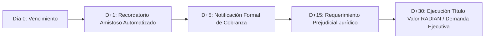

# Runbook 03: Protocolo de Cobranza Prejudicial y Gestión de Mora (`docs/runbooks/RUNBOOK-03-OVERDUE-COLLECTIONS.md`)

**Código de Incidente:** `INC-COL-03`  
**Severidad:** Media a Alta (P3 a P1 según volumen en mora)  
**Sistemas Afectados:** Motor Financiero (`FinancialEngine`), Estado de Operación (`PARTIALLY_SETTLED_OVERDUE`, `OVERDUE`), Módulo RADIAN (DIAN), Notificaciones Transaccionales.

---

## 1. Resumen Ejecutivo y Disparadores

Cuando una empresa contratante (pagador corporativo) no liquida el 100 % del valor nominal de una factura o hito en o antes de la fecha de vencimiento pactada (`due_date`), el sistema activa el protocolo de cobranza escalonada. Dependiendo del tipo de originación (Factura Electrónica UBL 2.1 con título valor RADIAN o Contrato por Hito con confirmación criptográfica), los mecanismos jurídicos y operativos de cobro varían.

### Disparadores de Alerta
- **`PAYMENT_OVERDUE_D1`:** Operación en estado `ACCEPTED` o `FUNDED` alcanza $T > \text{due\_date} + 24\text{ h}$ sin registro de recaudo bancario en la cuenta concentradora.
- **`PARTIAL_PAYMENT_OVERDUE`:** Recaudo parcial recibido ($< 100\ \%$ del nominal) y fecha de vencimiento superada (estado `PARTIALLY_SETTLED_OVERDUE`).

---

## 2. Cronograma Escalonado de Cobranza

---

## 3. Protocolo de Acción Paso a Paso

### Fase 1: D+1 a D+4 — Gestión Automatizada Amistosa
1. **Disparo de Correo y Webhook:**
   - Envío automático de notificación a la tesorería de la empresa pagadora:
     - Asunto: `[Recordatorio de Pago] Operación Proofly #${code} - ${clientName}`
     - Incluye enlace de pago PSE directo y datos bancarios para transferencia ACH con referencia única.
2. **Impacto en Cupo del Freelancer:**
   - El cupo disponible del freelancer (`available_limit_cents`) permanece congelado para nuevas originaciones si la mora supera $\$5.000.000\text{ COP}$ hasta que el pagador regularice.

### Fase 2: D+5 a D+14 — Cobranza Administrativa Directa
1. **Contacto con Representante de Cuentas por Pagar:**
   - El equipo de operaciones financieras de Proofly contacta telefónicamente al contacto corporativo verificado durante la originación.
2. **Verificación de Disputas de Calidad:**
   - Confirmar si existe alguna disputa comercial o inconformidad en el entregable del freelancer.
   - En originaciones por factura con acuse de recibo de mercancías/servicios en RADIAN, la aceptación tácita o expresa es **irrevocable e inoponible** por mandato del Código de Comercio colombiano.

### Fase 3: D+15 a D+29 — Requerimiento Prejudicial Escrito
1. **Emisión de Requerimiento Formal:**
   - Envío de carta de cobro prejudicial con firma digital certificada y constancia de entrega física.
2. **Cálculo de Intereses Moratorios:**
   - Aplicación de la tasa máxima de interés moratorio certificada por la Superintendencia Financiera de Colombia para el período correspondiente:
     $$I_{\text{mora}} = \text{SaldoCapital} \times \left( \left(1 + \text{TasaE.A.}_{\text{usura}}\right)^{\frac{\text{días}}{365}} - 1 \right)$$
3. **Reporte a Centrales de Riesgo:**
   - Notificación de aviso previo de reporte negativo a centrales de información crediticia (TransUnion / Datacrédito) según Ley 1266 de 2008 (Habeas Data).

### Fase 4: D+30 en adelante — Ejecución Coactiva y Jurídica

#### Caso A: Facturas Electrónicas registradas en RADIAN
- Dado que Proofly (o el fideicomiso de financiamiento) ostenta el **Endoso en Propiedad Electrónico** inscrito en el RADIAN de la DIAN:
  1. Se emite el certificado de existencia y trazabilidad del título valor electrónico expedido por el sistema RADIAN.
  2. Dicho documento presta **mérito ejecutivo pleno** e inmediato ante los juzgados civiles del circuito.
  3. Se radica la demanda ejecutiva con solicitud de medidas cautelares (embargo de cuentas bancarias de la empresa pagadora).

#### Caso B: Contratos por Hito (Milestones)
- Se compila el expediente probatorio:
  1. Contrato de prestación de servicios y términos aceptados.
  2. Acta de entrega o confirmación criptográfica firmada con el token de un solo uso por el cliente pagador.
  3. Trazabilidad de hashes HMAC inmutables generados durante la confirmación.
  4. Inicio de proceso verbal sumario o arbitral según la cláusula compromisoria del contrato marco.

---

## 4. Distribución del Recaudo Tardío entre Financiadores

Cuando se logra el cobro del capital en mora más los intereses moratorios:
1. **Recaudo del Saldo de Capital:**
   - Se procesa a través del `FinancialEngine` aplicando la cascada Waterfall para restituir a los financiadores de la operación el capital faltante.
2. **Distribución de Intereses de Mora:**
   - Los intereses moratorios recaudados se distribuyen **100 % a prorrata** entre los tenedores de tokens ERC-1155 de la operación, sin cobro de comisión de éxito adicional por parte de Proofly sobre dichos intereses como resarcimiento por el tiempo de espera.
   - Se utiliza el **Algoritmo del Mayor Resto** para garantizar cero centavos de pérdida en la asignación.
3. **Actualización de Estado On-Chain:**
   - El worker despacha `settleOperation` en `ProoflyOperations.sol` reflejando la cancelación total de la deuda.

